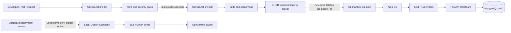

# OpsBoard | CI/CD, Security & GitOps Lab

**An end-to-end DevOps portfolio project:** a FastAPI operations dashboard, a local blue/green deployment simulator, security-gated GitHub Actions pipelines, immutable container releases, and GitOps-managed Kubernetes infrastructure.

> **Scope:** This is a local learning lab, not an internet-facing production service. The Docker Compose deployment controls and the Kubernetes deployment are **different environments**. Publishing a verified image to GHCR does **not** deploy it to Kubernetes automatically.

## Architecture



## What this project demonstrates

| Area | Implementation |
| --- | --- |
| Backend | FastAPI, SQLAlchemy, PostgreSQL/SQLite, Jinja2 + browser UI |
| Local deployments | Docker Compose blue/green simulator, Nginx traffic switch, readiness and rollback checks |
| CI | Seven jobs covering Python, code quality, dependency/security scans, secrets, API attack testing, and browser checks |
| CD | Publish a commit-tagged GHCR image, SBOM/provenance, Trivy policy gate, authenticated smoke tests, isolated OWASP ZAP scan, then promote to `latest` |
| GitOps | Argo CD watches `main:k8s/opsboard`; app image is pinned by SHA-256 digest |
| Kubernetes | Non-root FastAPI Deployment, health/readiness probes, PostgreSQL StatefulSet + PVC, Secret references |
| Security | Expiring bearer tokens, viewer/operator roles, bounded requests, CSP, audit metadata without token logging, fail-closed security gates |

### Repository map

```text
app.py                   FastAPI API and dashboard routes
opsboard/                Database models, security, deployments and operations
static/, templates/      Dashboard frontend
scripts/                 Local deployment, rollback, release security and helpers
tests/                   Backend, deployment and security regression tests
.github/workflows/       CI and CD pipelines
Dockerfile               Hardened OpsBoard application image
Dockerfile.demo          Isolated blue/green demo service image
compose.yml              Local PostgreSQL + blue/green demo + Nginx
k8s/                     Argo CD definition, application and database manifests
docs/                    Operational, GitOps and security runbooks
```

## Quick start: local blue/green demo

Prerequisites: Docker Engine and Docker Compose v2. On a Linux host, use a Docker connection that you are authorized to access; `sudo docker` may be required. Docker access grants powerful host privileges.

```bash
# From the repository root
docker compose up -d --build db demo-blue demo-green nginx
curl --fail http://127.0.0.1:8080/ready
curl --fail http://127.0.0.1:8080/version
```

- Nginx demo endpoint: `http://127.0.0.1:8080`
- Blue and green demo endpoints: `http://127.0.0.1:8001` and `:8002`
- Development-only PostgreSQL: `127.0.0.1:5432`

**Warning:** `compose.yml` includes a **known development database password**. It is local-only demo configuration, not a production credential. Do not expose its database port or reuse those credentials. The Compose file does **not** start the OpsBoard dashboard; run it separately as described below.

The privileged blue/green deployment scripts live in `scripts/deploy.sh` and `scripts/rollback.sh`. Only enable their API execution after reviewing their Docker/sudo prerequisites and failure modes; it is disabled by default and always disabled in the supplied Kubernetes manifest.

## Quick start: OpsBoard API and dashboard (safe local lab)

Requires **Python 3.14**. The example uses a private temporary SQLite database and fresh credentials; it does not modify an existing PostgreSQL database.

```bash
# Run from the repository root
python3.14 -m venv .venv
.venv/bin/python -m pip install -r requirements-dev.txt

mkdir -p "$HOME/.config/ci-cd-lab"
LAB_DIR="$(mktemp -d "$HOME/.config/ci-cd-lab/local.XXXXXXXX")"
.venv/bin/python scripts/create-security-credentials.py "$LAB_DIR/credentials"

export OPSBOARD_AUTH_FILE="$LAB_DIR/credentials/auth.json"
export DATABASE_URL="sqlite:///$LAB_DIR/opsboard.db"
export OPSBOARD_ALLOWED_HOSTS="127.0.0.1,localhost"
export OPSBOARD_ENABLE_DEPLOYMENTS=false

.venv/bin/python -m uvicorn app:app --host 127.0.0.1 --port 18001 \
  --no-access-log --no-server-header --no-proxy-headers
```

Open `http://127.0.0.1:18001/dashboard`. Read **your locally generated** `viewer.token` or `operator.token` and enter it in the dashboard; never commit, publish or paste tokens into issue reports. The token is held in the browser session's JavaScript memory, not local storage. Operator tokens allow protected API writes; deployment execution remains disabled in this example.

Useful endpoints:

| Endpoint | Purpose | Access |
| --- | --- | --- |
| `/health` | Process liveness | Public |
| `/ready` | DB and auth configuration readiness | Public |
| `/version` | Running release identifier | Public |
| `/dashboard` | Locked dashboard shell | Public; data requires token |
| `/docs` | OpenAPI UI | Public; API calls need bearer token |
| `/api/incidents`, `/api/deployments` | Read or create records | Authenticated; writes require operator |
| `/api/operations/*` | Local Compose deploy/rollback controls | Operator **and** explicit opt-in |

For detailed environment and security setup, see [Security lab](docs/security-lab.md).

## Tests and quality gates

```bash
.venv/bin/python -m pytest -q
.venv/bin/python -m ruff check .
.venv/bin/python -m ruff format --check .
.venv/bin/python -m bandit -r app.py opsboard demo_service scripts -ll -ii
.venv/bin/python -m pip_audit -r requirements.txt
```

Browser security tests use Playwright/Chromium and require an explicit opt-in. See [Security lab](docs/security-lab.md). `tests/security/` contains authorization, injection, HTTP guard, credential, transport and browser regressions. `tests/test_container_security_policy.py` tests the same image policy used by CI and CD.

**CI:** Runs on pull requests and changes to `main`. The seven job names are `Python tests`, `Container security`, `Dependency security`, `Code quality`, `Isolated API attack scan`, `Secret security`, and `API and browser security`.

**CD:** Triggered after successful CI for a **push to `main`**. It builds and pushes an immutable commit-tagged image to GHCR, generates SBOM and provenance attestations, applies Trivy security policy, tests the published digest, and only then promotes the candidate to `latest`. See [Container security policy](docs/container-security-policy.md). `latest` is a convenience tag; **deploy by immutable digest**.

## Kubernetes and GitOps release flow

Argo CD follows `main:k8s/opsboard` from this repository. The manifest defines the OpsBoard Deployment/Service and a PostgreSQL StatefulSet with a 1 Gi PVC. Credentials are created **outside Git** in Kubernetes Secrets. Do not point a test runner at a live database.

1. Confirm a successful CD run and extract its canonical `OPSBOARD_VERIFIED_RELEASE` record, including `git_sha` and published `image` digest.
2. Create a **reviewed GitOps PR** updating all three values in `k8s/opsboard/app.yaml`: `image`, `APP_VERSION` (`sha-<short SHA>`), and `GIT_SHA` (full SHA). Preserve Secret references and PVC settings.
3. Wait for PR CI, merge, and let Argo CD synchronize `main` (auto-sync is enabled). **Do not bypass GitOps with `kubectl set image`.**
4. Confirm `Synced/Healthy`, updated/ready Pod, actual container digest, `/health`, `/ready`, `/version`, and PVC identity.

A healthy Argo CD application can still run an **older verified image** if the manifest has not been promoted. Git commit revision and running application version are not interchangeable: the GitOps commit may only change deployment metadata, while `/version` identifies the pinned application build.

Read the full [GitOps setup](docs/kubernetes-gitops.md) and [Release checklist](docs/release-checklist.md). `scripts/prepare-security-promotion.py` is the **initial auth-wiring helper only**; after auth is wired, use a reviewed three-field manifest update.

## Rollback and data safety

- **Docker Compose demo:** `scripts/rollback.sh` targets the local Nginx blue/green simulator, not Kubernetes. Inspect existing Nginx configuration and the target slot before running. Its failure recovery needs separate fault-injection validation; treat it as a lab script.
- **Kubernetes:** restore a previously verified `image`, `APP_VERSION` and `GIT_SHA` together in a reviewed GitOps PR. Wait for Argo CD and verify the actual running digest. Do not change the database Secret or PVC as part of an application rollback.
- **Persistence:** the PostgreSQL PVC can survive Pod replacement but is **not a backup**. Successful `/ready` and an unchanged PVC UID do not prove record-level restore. A real persistence drill needs known test data before/after and a verified backup/restore procedure.

## Security policy and explicit limits

The Trivy gate blocks all `CRITICAL` issues and `HIGH` issues with a vendor fix; `HIGH` findings without a fix are reported but **allowed in this lab**. Scanner/database failures block release. A passing build does **not** mean zero vulnerabilities or production certification.

This project intentionally does **not** claim hardened internet exposure, managed TLS/Ingress, OIDC/MFA, database backups, multi-cluster high availability or enterprise-grade monitoring. Review [Security lab](docs/security-lab.md) and [Container security policy](docs/container-security-policy.md) before adopting any component elsewhere.

## Project status

- Verified in the November 2026 lab: seven CI jobs passed on PR and `main`; CD successfully published and security-tested the candidate image.
- GitOps remains an **explicit promotion step**, not an automatic effect of CD. Check the live manifest and application before claiming deployment of any specific version.
- No license has been chosen for this repository; do not assume it is open source.
