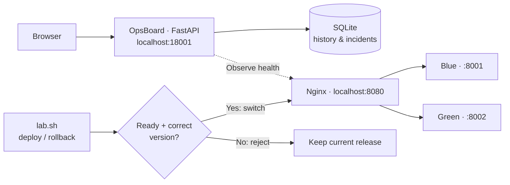
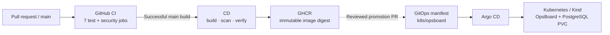

# OpsBoard

**CI/CD · Blue/Green Deployments · Security · GitOps**

[](https://github.com/Mishkaaass/ci-cd-lab/actions/workflows/ci.yml) [](https://github.com/Mishkaaass/ci-cd-lab/actions/workflows/cd.yml) [](https://github.com/Mishkaaass/ci-cd-lab/releases/tag/v1.0.0)

A hands-on DevOps lab: **make a release, reject a broken deployment, switch live traffic, and roll back safely.** It combines a FastAPI dashboard, Docker Compose, GitHub Actions, GHCR, Kubernetes and Argo CD.

> **Know the difference:** The local Blue/Green demo and the Kubernetes GitOps deployment are **separate environments**. A successful CD run publishes an image; it **does not automatically deploy it** to Kubernetes. This is a learning lab, not a public production service.

## 1. Architecture

**Local lab — the part you can run on your laptop**



Nginx sends traffic to **one slot at a time**. The other slot is where a new candidate is tested. The browser observes the process; the **terminal controls deployment** by default.

**Automated delivery — the path from Git to Kubernetes**



## 2. Quick start (two terminals)

**You need:** Linux/Ubuntu, Git, Python **3.14**, `curl`, and Docker Engine + Compose v2 for the Blue/Green demo. On Linux, Docker commands may require `sudo`. Clone with a GitHub account that has repository access.

```bash
git clone https://github.com/Mishkaaass/ci-cd-lab.git
cd ci-cd-lab
```

If you already cloned it, **use that checkout** instead. All commands below run from the folder containing `app.py`, `compose.yml` and `scripts/lab.sh`. Do not start a second Compose stack from another clone on the same ports.

**Terminal A — launch the dashboard (leave running)**

```bash
bash scripts/lab.sh start
```

Open **http://127.0.0.1:18001/dashboard**. To find your private login token, open Terminal B and run:

```bash
bash scripts/lab.sh tokens
```

Read the `viewer.token` file using the printed command, paste its value into **Unlock**, and click **Unlock**. `viewer` can inspect; `operator` can also write incidents. **Never share or commit tokens.** The browser's Deploy buttons are intentionally disabled in safe local mode.

**Terminal B — start the Docker demo**

```bash
sudo -v
bash scripts/lab.sh demo
bash scripts/lab.sh status
```

Visit **http://127.0.0.1:8080/version** to see the release actually served by Nginx. The demo uses four containers: `db`, `demo-blue`, `demo-green`, and `nginx`.

## 3. Try a real deployment and rollback

Run these **one at a time in Terminal B**:

```bash
# 1. Intentionally broken: fails readiness; live traffic must stay unchanged.
bash scripts/lab.sh deploy broken v2.0.0 demo-bad

# 2. Healthy: validates the inactive slot, then switches live traffic.
bash scripts/lab.sh deploy healthy v2.0.1 demo-good

# 3. Roll back to the previous healthy release.
bash scripts/lab.sh rollback

# 4. Confirm what is live now.
bash scripts/lab.sh status
curl -fsS http://127.0.0.1:8080/version
```

**Expected:** Step 1 reports an error **on purpose**, with no traffic switch; step 2 deploys successfully; step 3 restores the earlier release. Keep the dashboard running to view the **Guided Local Lab** activity and deployment history. A rollback changes the local Nginx route, **not the Kubernetes cluster or database contents**.

## 4. What happens behind the scenes?

| Step | What the system does | Why it matters |
| --- | --- | --- |
| **Build** | CI runs tests and security checks | Bad changes are blocked before release |
| **Publish** | CD scans and verifies an image, then publishes it to GHCR | Releases are traceable by SHA-256 digest |
| **Deploy (local)** | Recreates only the *inactive* Blue/Green container | The live slot keeps serving requests |
| **Verify + switch** | Checks `/ready` and `/version`, validates Nginx, then switches traffic | Users receive only the validated candidate |
| **Rollback** | Checks the previous healthy slot and restores its route | Fast recovery without rebuilding |
| **GitOps** | A reviewed manifest change tells Argo CD which digest to run | Kubernetes state is controlled through Git |

**To ship a new release:** open a pull request, wait for all seven CI jobs to pass, then merge to `main`. CD builds, scans and publishes the verified image to GHCR. **To run it on Kubernetes**, update the verified `image`, `APP_VERSION` and `GIT_SHA` together in a separate reviewed PR to `k8s/opsboard/app.yaml`; Argo CD syncs it. Kubernetes rollback uses a GitOps revert, **not** `lab.sh rollback`.

## 5. Useful commands

| Task | Command |
| --- | --- |
| Open dashboard | `http://127.0.0.1:18001/dashboard` |
| Check local services | `bash scripts/lab.sh status` |
| Find token files | `bash scripts/lab.sh tokens` |
| Check dashboard readiness | `curl -fsS http://127.0.0.1:18001/ready` |
| See the live demo version | `curl -fsS http://127.0.0.1:8080/version` |
| View demo containers | `sudo docker compose ps` |
| Test local Nginx routing | `python3 scripts/nginx_route.py check` |
| Run automated Python tests | `.venv/bin/python -m pytest -q` |
| Stop the dashboard | `Ctrl+C` in Terminal A |

**Where data lives:** local dashboard history uses private **SQLite**; the Compose `db` container is a separate demo PostgreSQL instance; Kubernetes uses its **own PostgreSQL + PVC**. None of these databases is an automatic backup of the others.

## 6. Troubleshooting & safety

| Symptom | Fix |
| --- | --- |
| Dashboard unavailable on `:18001` | Run `bash scripts/lab.sh start` and keep that terminal open |
| Demo unavailable on `:8080` | Check `bash scripts/lab.sh status` and `sudo docker compose ps` |
| Docker permission error | Run `sudo -v` in the **same terminal**, then retry |
| Broken deploy exits with an error | **Expected.** Confirm the live version did not change |
| Port conflict / another checkout owns containers | Inspect `sudo docker ps`; do not stop or overwrite an unknown stack |
| Rollback blocked | Previous slot is not ready; investigate before switching traffic |

**Safe defaults:** credentials stay outside Git, web-triggered Docker deployment is disabled, and scripts should never need `docker compose down -v`. Docker access is privileged; use this lab only on trusted local machines. To stop the demo without deleting its volumes, run `sudo docker compose stop` **only from the checkout that owns its containers**.

## 7. Repository guide & verified release

| Path | Purpose |
| --- | --- |
| `app.py`, `opsboard/` | API, authentication, monitoring, database and operations |
| `templates/`, `static/` | Dashboard UI |
| `scripts/lab.sh`, `scripts/deploy.sh`, `scripts/rollback.sh` | Local lab and Blue/Green controls |
| `.github/workflows/` | CI/CD pipelines |
| `compose.yml`, `Dockerfile*` | Local services and container images |
| `k8s/` | Kubernetes manifests and Argo CD |
| `tests/`, `docs/` | Tests and deeper technical guides |

**[Release v1.0.0](https://github.com/Mishkaaass/ci-cd-lab/releases/tag/v1.0.0)** · validated on **10 Nov 2026**: CI **7/7**, CD **passed**, final audits **20/20**, deployment drill **14/14** (broken rejected → healthy promoted → rollback restored), and Argo CD **Synced / Healthy**. The PostgreSQL PVC was preserved during the verified lab run.

For deeper details: [GitOps setup](docs/kubernetes-gitops.md) · [Release checklist](docs/release-checklist.md) · [Security lab](docs/security-lab.md) · [Container security policy](docs/container-security-policy.md).
