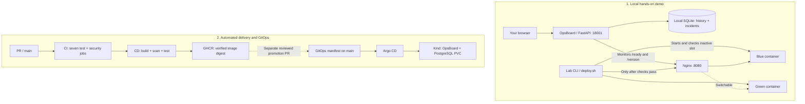

# OpsBoard — CI/CD, Blue/Green & GitOps Lab

A hands-on DevOps portfolio project: **run an operations dashboard, deliberately break a release, recover traffic, and trace the same release principles through GitHub Actions, GHCR, Argo CD and Kubernetes**.

> **Start here:** This is a **local learning lab**, not a production-ready hosting service. You do **not** need AWS, Kubernetes or an existing database just to explore the dashboard. The dashboard's local demo and the GitOps Kubernetes deployment are **two separate environments**.

## In two minutes: what am I looking at?

| Part | Why it exists | Where it runs |
| --- | --- | --- |
| **OpsBoard dashboard** | Shows service status, deployments, incidents and operation history | FastAPI on `127.0.0.1:18001` |
| **Blue / Green demo** | Keeps one service active while testing a replacement before switching traffic | Docker Compose: `demo-blue`, `demo-green`, Nginx |
| **Local data** | Stores dashboard incidents and deployment records for this walkthrough | Private SQLite file on your computer |
| **CI** | Checks every pull request and push to `main` | GitHub Actions (seven jobs) |
| **CD** | Builds, scans, tests and publishes a verifiable Docker image | GitHub Actions + GHCR |
| **GitOps** | Deploys a *chosen, digest-pinned* release, with Git as the desired state | Argo CD + local Kind Kubernetes + PostgreSQL PVC |



## Quick start — no prior knowledge of this repo required

**Requirements:** Ubuntu/Linux terminal, Git, Python **3.14** (with `venv` and `pip`), and `curl`. Docker Engine with `docker compose` is required **only** for the Blue/Green demo. Your Linux account may need `sudo` to access Docker. Check your tools with `python3.14 --version` and `sudo docker compose version`.

### Step 0 — Get the code and find the "repository root"

The **repository root** is the folder containing `app.py`, `compose.yml` and `scripts/`. It is **not** an arbitrary folder under `~/projects`.

**First-time visitor:**

```bash
git clone https://github.com/Mishkaaass/ci-cd-lab.git
cd ci-cd-lab
ls app.py compose.yml scripts/lab.sh
```

If the clone requires authentication, sign into GitHub with an account that can access this repository.

**Already have a checkout but it is on an old branch?** Use a separate directory for the latest `main`; this does not overwrite your original checkout:

```bash
SOURCE="$HOME/projects/ci-cd-lab-ci-cd-platform"
git -C "$SOURCE" fetch origin main
NEW="$HOME/projects/ci-cd-lab-learning-$(date +%Y%m%d-%H%M%S)"
git -C "$SOURCE" worktree add --detach "$NEW" origin/main
cd "$NEW"
ls app.py compose.yml scripts/lab.sh
```

**Important:** Stay in this **same repo directory** in both terminals below. Running a second Compose project from another checkout may collide on ports. Avoid copying the contents of a `.py` file into Bash: execute scripts with `bash` or `python3` as shown.

### Step 1 — Start the dashboard (terminal A)

From the repository root:

```bash
bash scripts/lab.sh start
```

The helper checks Python, prepares `.venv`, installs dependencies, creates **private viewer/operator tokens**, uses a local SQLite database, and starts FastAPI. On later runs it reuses the same private files instead of overwriting them. **Leave this terminal running** and open:

**<http://127.0.0.1:18001/dashboard>**

It prints the location of token files without printing the tokens themselves. To locate them again, open a **second terminal in the same repository** and run:

```bash
bash scripts/lab.sh tokens
```

Read `viewer.token` locally using the `cat` command printed by the helper. Paste the token into the dashboard and click **Unlock** (not just Paste). A viewer can read data; an `operator.token` can also perform authorized API writes. **Never commit, screenshot or share a token.** Tokens expire after 30 days by default. A `401` request before you unlock is expected.

Once unlocked, the dashboard may initially say the demo service is **down** — this is normal until the next step. **Deploy buttons are deliberately disabled in this safe first-time setup.** You will use the interactive terminal demo below; enabling server-side Docker execution requires a separate privileged configuration.

### Step 2 — Start the Blue/Green demo (terminal B)

With Docker Engine running, from the **same repository root**:

```bash
bash scripts/lab.sh demo
bash scripts/lab.sh status
```

This creates/starts four containers: PostgreSQL, blue, green, and Nginx. It may build/recreate demo containers; it **does not remove volumes**. The script checks **ports 5432, 8001, 8002 and 8080 before starting** and stops if another service owns one. It will not silently stop old containers to make room.

The demo's public endpoint is **<http://127.0.0.1:8080/version>**. Nginx initially routes traffic to **blue**; green is the spare slot. Refresh the dashboard to see health and the active service version. The dashboard monitors Nginx on port `8080`, not a hard-coded blue-only address.

> **Database clarification:** the dashboard launched in Step 1 uses a **private SQLite database**. The Compose `db` container is present for the wider lab but is **not** automatically connected to that local dashboard. The Kubernetes installation uses PostgreSQL separately.

### Step 3 — Run your first release drill (terminal B)

Follow this **exact order** so a healthy rollback target remains available:

```bash
# A: Try a broken candidate on the inactive slot.
bash scripts/lab.sh deploy broken v2.0.0 broken001

# B: Deploy a healthy candidate to the same inactive slot.
bash scripts/lab.sh deploy healthy v2.0.1 healthy001

# C: Switch traffic back to the previously healthy slot.
bash scripts/lab.sh rollback

# D: Inspect the current release and readiness.
bash scripts/lab.sh status
```

**What should happen?**

1. **Broken candidate:** Docker starts the inactive slot in broken mode; `/ready` never passes, so the deploy command **fails on purpose** and Nginx continues serving the original blue slot. An error/exit code in this first command is **expected**.
2. **Healthy candidate:** The helper targets the inactive slot again, checks `/ready`, checks its `/version` against the requested version/SHA, validates Nginx config, switches traffic and verifies the live endpoint. Your dashboard's **Deployment History** can record this action.
3. **Rollback:** The script checks the other slot's readiness and release identity, switches Nginx back and verifies the result. It does **not** restore the database or roll back Kubernetes.

**Why broken comes first:** a broken deploy recreates its target slot. If you deploy healthy, then overwrite the *previous healthy slot* with a broken candidate, you lose the easy rollback target. This walkthrough preserves it by running the broken test first.

The CLI is intentionally separate from the web Deployment Control buttons. The CLI uses interactive `sudo docker compose`; it can ask for your local sudo password. In contrast, a web-server background task has **no terminal to ask for sudo credentials**, so the safe starter does not pretend those buttons work. The local CLI writes Deployment History through an authenticated API callback when the dashboard is running. After **Unlock**, the prominent **Guided Local Lab** card shows the actual configured routing slot, Nginx's live release version and the most recent CLI outcomes (refreshed every five seconds). The card also reads structured `OPSBOARD_STEP` markers from a private local activity file, so it shows **actual CLI execution steps while the command is running** without executing Docker from the web process. The separate **Operation Timeline** is only for operations queued via the browser API. The dashboard buttons remain disabled in safe terminal mode.

**Important safety guard:** `deploy`, `rollback`, and `demo` now refuse to operate on containers that Docker Compose associates with a **different checkout directory**, even if both clones happen to use the same Compose project name. This prevents silent changes to another lab. If you see this warning, use the directory shown as the owner or intentionally stop that old Compose stack before starting from a new directory. The script will not stop or delete anything automatically.

### Step 4 — Explore the API and incidents (optional)

Open **<http://127.0.0.1:18001/docs>** for the FastAPI Swagger UI. Use **Authorize** with your locally generated `operator.token` to call the protected API. Try:

- `GET /api/auth/me` — which role am I using?
- `GET /api/dashboard` — what state does the browser display?
- `POST /api/incidents` — add a practice incident with `{"service":"demo-api","severity":"warning","reason":"Learning the incident lifecycle"}`.
- `GET /api/incidents` — find the new record's ID; `POST /api/incidents/{incident_id}/resolve` — mark it resolved.

Refresh the dashboard and watch the incident count/status change. The request travels through **Bearer authentication → FastAPI route → SQLAlchemy → SQLite → dashboard refresh**. The API docs may load Swagger assets from a CDN.

### When you are done

Press **Ctrl+C** in terminal A to stop only the local FastAPI process. Demo containers continue running until you deliberately stop them. To stop **only the containers belonging to this checkout's Compose project**, inspect the project first and then, if you intend to stop them, run `sudo docker compose stop` from the same repository root. `stop` preserves named volumes; do **not** run `down -v` unless you explicitly intend to delete demo data.

## Troubleshooting (the problems most beginners hit)

| You see | What it means / what to do |
| --- | --- |
| `scripts/lab.sh: No such file` | You are in an old checkout or wrong folder. Return to **Step 0** and verify the file exists. |
| `python3.14: command not found` | Install Python 3.14 and its `venv` support for your Linux distribution; do not silently use an older interpreter. |
| Dashboard starts but `/ready` is `503` | Authentication or SQLite is not configured correctly. Use `bash scripts/lab.sh start` and preserve the private credential directory for inspection. |
| Pasting a token appears to do nothing | Click **Unlock** and watch the status beside the form. `viewer` is read-only; the dashboard's Deploy buttons stay disabled by design in safe mode. |
| `permission denied ... /var/run/docker.sock` | Docker on Linux needs permission. The lab helper uses `sudo docker`; Docker access is effectively root-level, so don't add users to privileged groups casually. |
| `Bind for 127.0.0.1:8001 failed: port is already allocated` | A container/process from another checkout already uses the port. Run `sudo docker ps --format 'table {{.Names}}\t{{.Ports}}'` and `sudo ss -lntp` to identify it. **Do not automatically delete or stop it.** |
| `curl ...:8080/version` works but Docker Compose failed | You may be contacting a **different old stack**. Trust the Compose command's exit status and inspect container names, not the curl response alone. |
| Dashboard shows service down, although the dashboard is open | `18001` is the control UI; `8080` is the separate Nginx demo. Start the demo in terminal B and refresh the UI. |
| Broken deployment reports failure | **Expected:** the readiness gate rejected the candidate and did not switch Nginx. |
| Rollback fails | Check the other slot with `/ready` first. Rollback is blocked when the target is unhealthy; do not force traffic to it. |

Read-only checks from the repository root:

```bash
bash scripts/lab.sh status
sudo docker compose ps
curl -i --max-time 5 http://127.0.0.1:18001/ready
curl -i --max-time 5 http://127.0.0.1:8080/version
```

## How the application works behind the scenes

### Local deployment flow

1. **Browser + token:** `static/dashboard.js` sends Bearer-authorized requests to protected `/api/*` routes in `app.py`. The token is checked against hashes/expiry in `OPSBOARD_AUTH_FILE`; a viewer cannot write.
2. **State:** `opsboard/models.py`, `opsboard/database.py` and SQLAlchemy store incidents, deployments and queued operations. In this beginner walkthrough, that database is local SQLite, not the Compose PostgreSQL container.
3. **Monitoring:** `opsboard/monitor.py` probes the *active Nginx service* through `/health`, `/ready`, `/probe` and `/version`. A service can respond to `/health` but still fail `/ready`.
4. **Safe deployment:** `scripts/deploy.sh` identifies the inactive blue/green slot in `nginx/active_backend.inc`, recreates only that demo container, waits for readiness, compares release identity, validates/reloads Nginx and verifies production traffic.
5. **Recovery:** `scripts/rollback.sh` switches Nginx to the other *ready* slot and verifies that version. This is a learning-grade local rollback, **not** a transactional disaster-recovery guarantee.
6. **Operations API:** When explicitly enabled in a properly privileged, trusted lab, `/api/operations/*` queues an operation and a background runner captures its steps. This is deliberately disabled by the beginner launcher because browser-triggered Docker/sudo execution requires a reviewed privilege setup.

### CI → CD → GitOps: the second environment

1. **Pull request:** GitHub Actions CI runs seven checks: Python tests; code quality; secrets; dependency security; container security; isolated API attack scan; API/browser security.
2. **Push to `main`:** Only after successful CI, CD builds the application image, publishes it under a source-commit tag to GHCR, generates **SBOM/provenance**, applies the **Trivy gate**, and tests the published image by immutable SHA-256 digest. The verified candidate may also receive the mutable `latest` tag.
3. **Promotion is separate:** A reviewed GitOps PR updates **three matching fields** in `k8s/opsboard/app.yaml`: `image` digest, `APP_VERSION` and full `GIT_SHA`. A green CD does **not** mean that Kubernetes is already running that image.
4. **Argo CD:** Watches `main:k8s/opsboard` and reconciles the Kind cluster to the committed manifests. The Kubernetes OpsBoard Pod uses PostgreSQL with a PVC; the running image is pinned by digest.
5. **Verification/rollback:** Check Argo `Synced/Healthy`, Pod readiness, the *running image digest*, API `/ready` + `/version`, and PostgreSQL PVC identity. For rollback, restore the **previous verified image and matching version metadata in a GitOps PR**, not `kubectl set image`.

**Important distinction:** the Git commit that updates the GitOps manifest can be newer than the application image's `git_sha`. That is expected: a release is promoted **after** it was built and verified.

## Repository map

```text
app.py                       FastAPI routes and dashboard
opsboard/                    Authentication, DB models, monitoring, incidents, operations
static/ and templates/       Browser dashboard
scripts/lab.sh               Beginner-safe local lab entry point (this guide)
scripts/deploy.sh             Local blue/green release with readiness checks
scripts/rollback.sh           Local Nginx traffic rollback
compose.yml                  PostgreSQL + two demo services + Nginx (NOT dashboard)
Dockerfile / Dockerfile.demo  Application image / small demo image
.github/workflows/           CI and CD (GitHub Actions)
k8s/                         Kubernetes manifests and Argo CD app
tests/                       Functional, deployment and security regressions
docs/                        Security, GitOps and operational reference guides
```

## Advanced docs, safety and project scope

- [Kubernetes and GitOps setup](docs/kubernetes-gitops.md)
- [Release checklist](docs/release-checklist.md)
- [Security testing lab](docs/security-lab.md)
- [Container vulnerability policy](docs/container-security-policy.md)

**Security policy:** The Trivy gate blocks **all CRITICAL** findings and **fixable HIGH** findings. Unfixed HIGH findings are reported but currently allowed in this learning lab; a green pipeline is not a clean-image guarantee. The Compose PostgreSQL password is for **local development only**; never expose this stack publicly or reuse those credentials. Tokens are generated outside the repo and are not stored in plain text in the application's auth file. Docker/sudo permissions are powerful.

**Scope:** This repository demonstrates a working local CI/CD/GitOps lab. It does **not** promise internet-facing security, OIDC/MFA, managed TLS, multi-cluster HA, backup/restore, fully automatic GitOps promotions or flawless rollback after arbitrary machine failures. A PVC surviving Pod replacement is not the same as a verified backup. For a public production system, review the remaining limitations before using any part of this design.

**Project evidence:** The lab previously passed CI **7/7** on PR and `main`, CD release gates, Argo CD `Synced/Healthy`, a running digest-verified Kubernetes Pod, and `/health`, `/ready`, `/version` checks. This README and helper must pass their own PR CI before being treated as part of the verified `main` revision.
