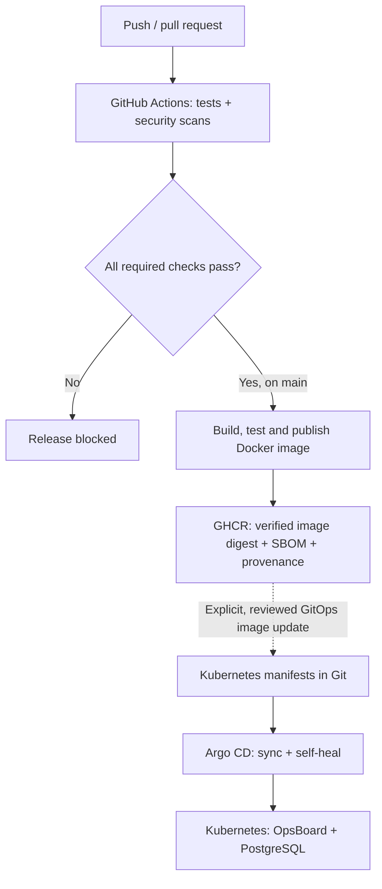
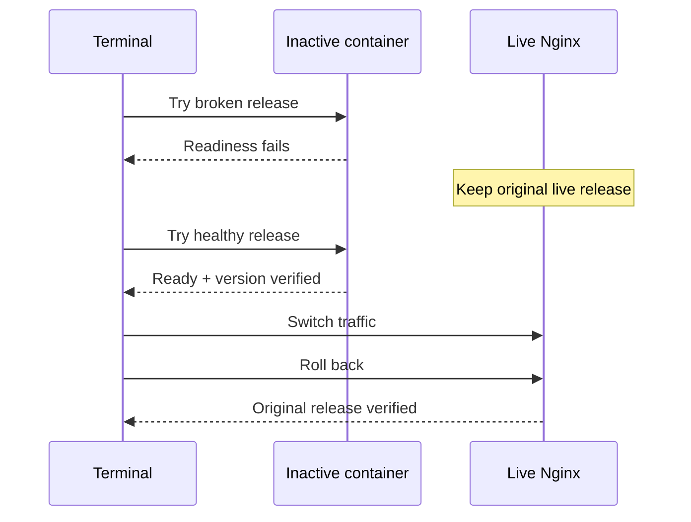

# OpsBoard | CI/CD & GitOps, hands-on

[](https://github.com/Mishkaaass/ci-cd-lab/actions/workflows/ci.yml)
[](https://github.com/Mishkaaass/ci-cd-lab/actions/workflows/cd.yml)
[](https://github.com/Mishkaaass/ci-cd-lab/releases/latest)

**An application, a real delivery pipeline, and two safe deployment demos.** See how code is tested, scanned, packaged, deployed and recovered from failure. Clone the repo, choose **one demo**, and follow the steps below.

> **What this is:** A reproducible **local DevOps lab**, not a hosted production service or AWS/EKS deployment. Docker Blue/Green and Kubernetes GitOps are **separate paths**, using the same repository. No cloud account required.

## What happens when code changes?



| Tool | Its job in this repo |
| --- | --- |
| **GitHub Actions** | Run seven CI checks; publish an image after successful `main` CI. |
| **Trivy / Gitleaks / other gates** | Scan images, dependencies, code and secrets; block failures against policy. |
| **SBOM / provenance** | Record image contents and build attestations. |
| **Docker + Nginx** | Run two app versions and direct live traffic to one. |
| **Deploy / rollback** | Promote only a verified version; restore the exact previous release. |
| **Kubernetes + Argo CD** | Run a Git-defined application and repair configuration drift. |
| **OpsBoard UI** | Show health and deployment history; privileged deploys stay in the terminal. |

## Choose a demo

Start once (Linux with Git, Bash and Docker; each guide lists its additional requirements):

```bash
git clone https://github.com/Mishkaaass/ci-cd-lab.git
cd ci-cd-lab
```

### Demo 1 — Docker Blue/Green (start here)

**Goal:** Prove that a broken release never receives traffic, a healthy release can go live, and rollback restores the original version.

**Needs:** Python **3.14** with `venv`, Docker Engine + Compose, `curl`. Run the next blocks from the **same checkout**.

**Terminal A — keep the dashboard running:**

```bash
bash scripts/reviewer.sh doctor  # Confirm no tools are marked MISSING
bash scripts/reviewer.sh dashboard
```

**Terminal B — start services and run the live drill:**

```bash
bash scripts/reviewer.sh up
bash scripts/reviewer.sh status
bash scripts/reviewer.sh drill
```

**What you should see:** `Broken candidate rejected` → traffic switches to the healthy version → `Rollback` restores the original release and Git SHA. The drill ends with `PASS` only after checking the live service.

Open [**OpsBoard**](http://127.0.0.1:18001/dashboard). For the **Unlock** form, run `bash scripts/reviewer.sh tokens` in Terminal B to find your local **viewer token file**; read its contents **on your machine only**. The browser shows results; deploy buttons are intentionally disabled.

**[Full beginner walkthrough → Docker Blue/Green](docs/demo-docker-blue-green.md)**



### Demo 2 — Kubernetes + Argo CD (independent)

**Goal:** Prove that Kubernetes runs the application and Argo CD restores the state defined in Git after someone changes it manually.

**Needs:** Docker, [kind](https://kind.sigs.k8s.io/docs/user/quick-start/), [kubectl](https://kubernetes.io/docs/tasks/tools/), Git and internet access. No Python 3.14 dashboard setup required for this lab.

```bash
bash scripts/gitops-demo.sh doctor
bash scripts/gitops-demo.sh up
bash scripts/gitops-demo.sh status
bash scripts/gitops-demo.sh drift-test
```

**What you should see:** A new **isolated** kind cluster; Argo CD `Synced / Healthy`; OpsBoard and PostgreSQL running; a PVC `Bound`; then Argo CD restores replicas from **2 back to 1**.

Open the two interfaces with **separate terminals** (each command keeps running):

```bash
bash scripts/gitops-demo.sh ui   # Argo CD: https://127.0.0.1:18080
bash scripts/gitops-demo.sh app  # OpsBoard: http://127.0.0.1:18081/dashboard
```

**[Full beginner walkthrough → Kubernetes + Argo CD](docs/demo-kubernetes-argocd.md)**

> **Important:** Argo CD follows `main` on GitHub, **not** your uncommitted local files. Publishing to GHCR does **not** automatically update the Kubernetes image; promotion needs a reviewed manifest change. This demo tests **self-healing**, not an automatic Kubernetes image rollback.

## Evidence you can inspect

- [CI: seven checks](https://github.com/Mishkaaass/ci-cd-lab/actions/workflows/ci.yml) — unit tests, code quality, dependency/secret/image scans, API and browser security tests.
- [CD: verified image publishing](https://github.com/Mishkaaass/ci-cd-lab/actions/workflows/cd.yml) — GHCR image, digest verification, SBOM, provenance and security checks.
- [v1.1.0 validation](docs/evidence/v1.1.0-validation.md) — observed Blue/Green, Kubernetes, Argo CD, PVC and anonymous GHCR checks.
- [Security policy](docs/container-security-policy.md) · [GitOps details](docs/kubernetes-gitops.md) · [Troubleshooting](docs/reviewer-tour.md).

**Safety:** The demos bind web ports to `127.0.0.1`; secrets and private tokens stay outside Git. Don't share token contents. No setup command intentionally deletes volumes. The optional kind cleanup command **does delete that demo cluster and its PVC**; see the [Kubernetes guide](docs/demo-kubernetes-argocd.md).
