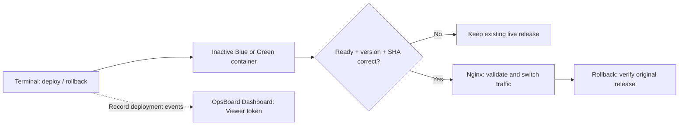
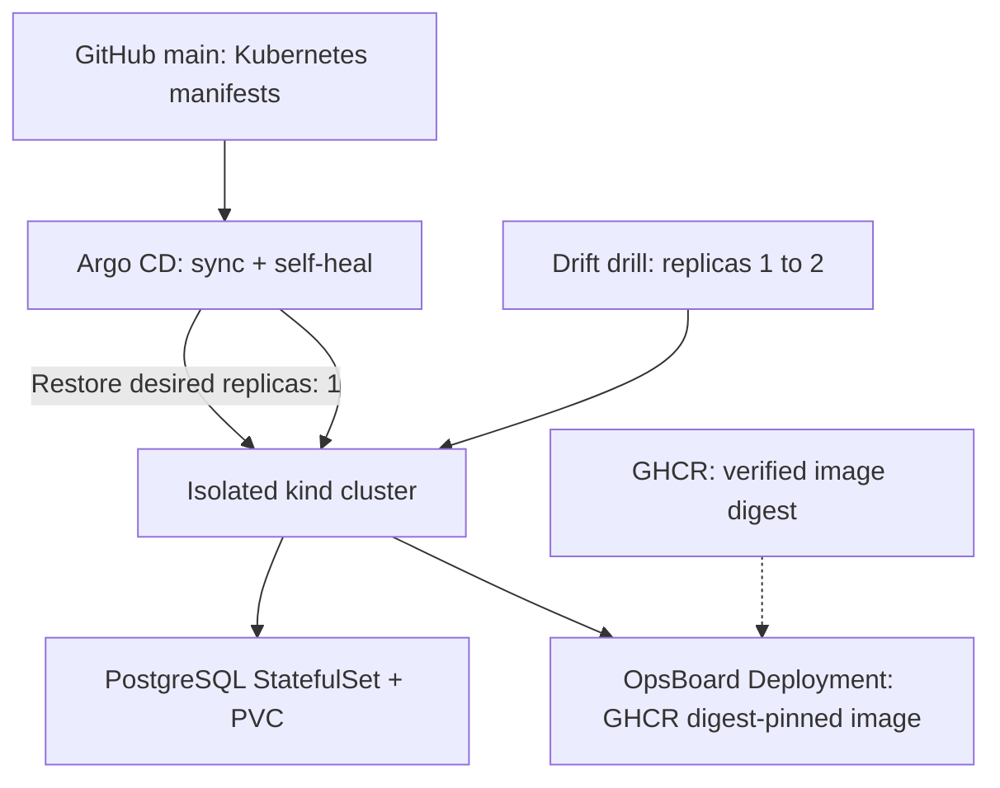

# OpsBoard — Secure CI/CD & GitOps Lab

[](https://github.com/Mishkaaass/ci-cd-lab/actions/workflows/ci.yml)
[](https://github.com/Mishkaaass/ci-cd-lab/actions/workflows/cd.yml)
[](https://github.com/Mishkaaass/ci-cd-lab/releases/latest)

**A hands-on DevSecOps platform that demonstrates safe software delivery, verified rollback and GitOps self-healing.** Run either demo on a Linux machine; no AWS account or paid cloud infrastructure required.

> **Scope:** Two **independent local labs**, not a production AWS/EKS deployment. Docker Blue/Green tests release safety; Kubernetes + Argo CD tests desired-state reconciliation. A new GHCR image is **not automatically promoted** to Kubernetes.

**Deployment boundaries:** The Docker Compose Blue/Green demo and the Kubernetes/Argo CD GitOps demo intentionally follow **separate paths**. Docker demonstrates candidate verification, traffic promotion, and rollback; Argo CD reconciles Kubernetes resources against Git. Passing CI and publishing an image does not automatically promote it to the GitOps deployment.

## How the delivery pipeline works

**Pull request → 7 GitHub Actions CI checks → approved `main` → CD → scanned image in GHCR** (verified digest, SBOM, build provenance). Failed security or quality gates block promotion. Kubernetes images are updated through a **reviewed GitOps manifest change**; Argo CD reconciles that desired state.

| Control | What it protects |
| --- | --- |
| **CI: 7 jobs** | Python tests, quality, API/browser checks, dependencies, secrets, containers and isolated attack testing |
| **Supply chain** | Gitleaks, dependency audit, Trivy image gate, SBOM, provenance and image digest verification |
| **Release safety** | Readiness + version/SHA checks before Nginx changes live traffic; verified rollback |
| **Least privilege** | Locally generated Viewer/Operator tokens; dashboard cannot execute privileged Docker commands |
| **GitOps** | Digest-pinned manifests, isolated Kubernetes context, Argo CD reconciliation and persistent PostgreSQL storage |

**Start with one demo.** Both use the same repository but can be run separately. On **Linux** with Git, Bash, Docker Engine and internet access:

```bash
git clone https://github.com/Mishkaaass/ci-cd-lab.git
cd ci-cd-lab
```

## Demo 1 — Docker Blue/Green: deploy, reject, roll back

**Goal:** Prove an unhealthy release cannot receive production-like traffic, a healthy release is promoted only after validation, and rollback restores the **original version and SHA**.



**Requires:** Linux, Docker Compose plugin, `curl`, Python **3.14 + venv**. Run `doctor` first; fix any reported missing dependency.

**Terminal A — start dashboard, leave running:**

```bash
bash scripts/reviewer.sh doctor
bash scripts/reviewer.sh dashboard
```

Open **[OpsBoard Dashboard](http://127.0.0.1:18001/dashboard)**. It requires a **Viewer token**, not a username/password. In **Terminal B**, retrieve the token generated locally by the dashboard:

```bash
bash scripts/reviewer.sh tokens
VIEWER_FILE="$(bash scripts/reviewer.sh tokens | sed -n 's/^Viewer token file:[[:space:]]*//p')"
test -s "$VIEWER_FILE" && cat -- "$VIEWER_FILE"
```

Copy the printed token into **Unlock**. It is a local secret: **never commit, screenshot or share it**. The separate Operator token is not needed for viewing the demo.

**Terminal B — start services and run the controlled failure drill:**

```bash
sudo -v
bash scripts/reviewer.sh up
bash scripts/reviewer.sh status
bash scripts/reviewer.sh drill
```

**Expected:** broken candidate **rejected, live traffic unchanged** → healthy candidate **promoted** → **exact rollback verified**. Look for the drill's final `PASS`, inspect [live release](http://127.0.0.1:8080/version), and refresh the dashboard for its event history. Its local audit history uses SQLite; the Compose PostgreSQL service is separate. The dashboard is for monitoring; **deployments run through guarded CLI scripts**, not a privileged web button.

**Stop safely:** `Ctrl+C` in Terminal A, then `sudo docker compose stop` from the same checkout. This preserves volumes. **Do not use `down -v`** unless you intend to delete data.

[Full Docker walkthrough and troubleshooting](docs/demo-docker-blue-green.md)

## Demo 2 — Kubernetes + Argo CD: GitOps self-healing

**Goal:** Prove the cluster converges back to the desired state stored in Git after a manual configuration change. This is **real Argo CD reconciliation in a local `kind` cluster**, not a second Blue/Green deployment.



**Requires:** Linux, working Docker, `kind`, `kubectl`, Python 3 and `curl`. You do **not** need Demo 1 or Python 3.14 for this path.

**Terminal A — create the lab and verify its health:**

```bash
bash scripts/gitops-demo.sh doctor
bash scripts/gitops-demo.sh up
bash scripts/gitops-demo.sh status
```

**Expected:** Argo CD `Synced / Healthy`, OpsBoard `1/1`, PostgreSQL running and PVC `Bound`.

**Terminal B — Argo CD UI (leave running):**

```bash
bash scripts/gitops-demo.sh ui
```

Open **https://127.0.0.1:18080** (a local self-signed certificate may trigger a browser warning). Login: **username `admin`**, password retrieved **locally** from the cluster's Secret using another terminal:

```bash
kubectl --kubeconfig "${XDG_STATE_HOME:-$HOME/.local/state}/opsboard-gitops-review/kubeconfig" \
  --context kind-opsboard-review -n argocd \
  get secret argocd-initial-admin-secret \
  -o jsonpath='{.data.password}' | base64 --decode
printf '\n'
```

**Terminal C — OpsBoard inside Kubernetes (leave running):**

```bash
bash scripts/gitops-demo.sh app
```

Open **http://127.0.0.1:18081/dashboard**. This is **not** the Argo CD login. Paste a separate **Viewer token** into **Unlock**; retrieve it in another terminal:

```bash
cat "${XDG_STATE_HOME:-$HOME/.local/state}/opsboard-gitops-review/auth/viewer.token"
```

**Run the reconciliation test** from an additional terminal:

```bash
bash scripts/gitops-demo.sh drift-test
bash scripts/gitops-demo.sh status
```

**Expected:** the script changes replicas **1 → 2**; Argo CD detects drift and restores **1** automatically. Both UIs should recover to a healthy state. Neither token nor admin password belongs in Git.

**Stop safely:** `Ctrl+C` stops the two UI port-forwards; **the cluster and PVC remain**. The optional `bash scripts/gitops-demo.sh down --delete-my-lab` **destroys the demo cluster and its PVC data**—run it only if you explicitly want to delete this lab.

[Full Kubernetes/Argo CD walkthrough and troubleshooting](docs/demo-kubernetes-argocd.md)

## Evidence and boundaries

- **[CI workflow](.github/workflows/ci.yml)** · **[CD workflow](.github/workflows/cd.yml)** · **[Latest release](https://github.com/Mishkaaass/ci-cd-lab/releases/latest)**
- [Security model](docs/security-lab.md) · [GitOps runbook](docs/kubernetes-gitops.md) · [Reviewer troubleshooting](docs/reviewer-tour.md)
- These are **local demonstrations**, not claims of a production Kubernetes/AWS rollout. GHCR publishing and GitOps deployment are deliberately **separate approval paths**.
