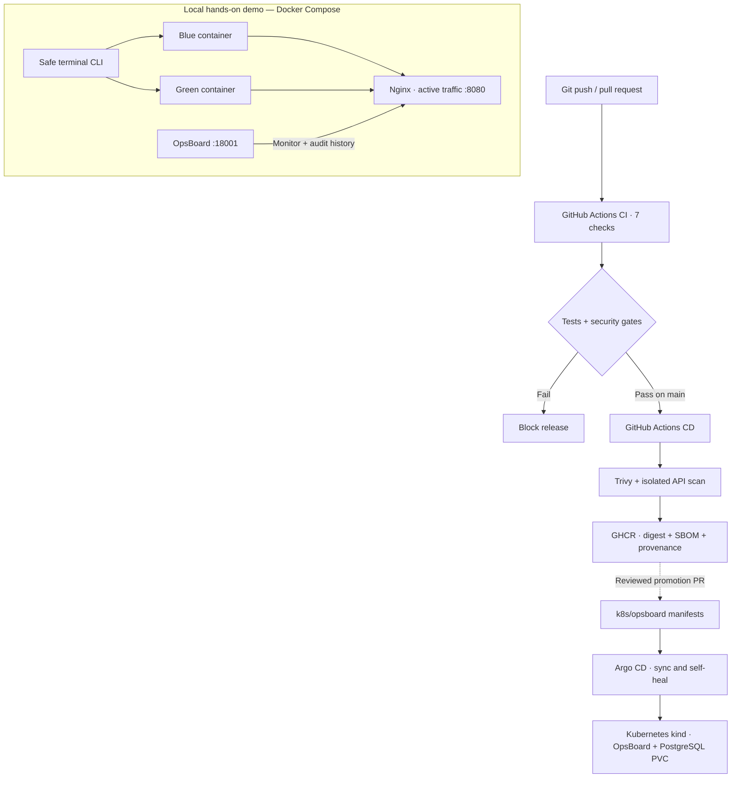
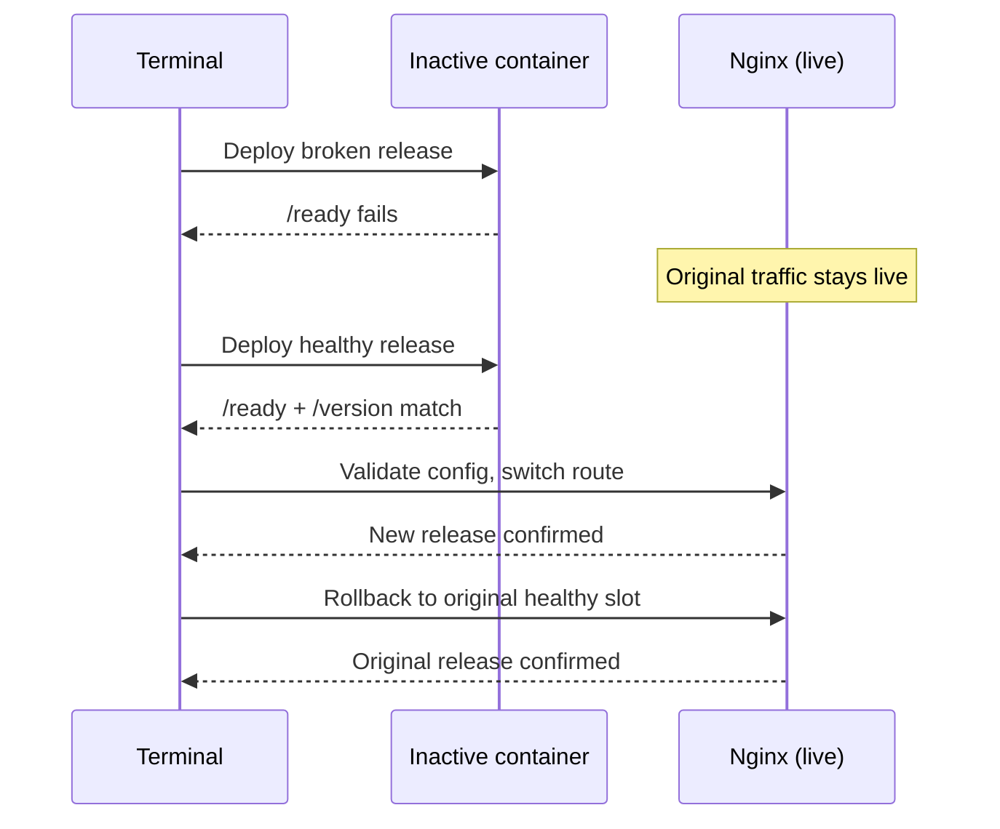

# OpsBoard · CI/CD Platform

[](https://github.com/Mishkaaass/ci-cd-lab/actions/workflows/ci.yml)
[](https://github.com/Mishkaaass/ci-cd-lab/actions/workflows/cd.yml)
[](https://github.com/Mishkaaass/ci-cd-lab/releases/latest)

**A real, security-gated delivery system you can run and break safely.** Build an image, verify it in GitHub Actions, deploy a healthy candidate, reject a broken one, roll back traffic, and inspect a separate Kubernetes/Argo CD GitOps environment.

> **Scope:** A reproducible **local DevOps lab**, not a production SaaS or AWS/EKS deployment. The Docker Blue/Green demo and Kubernetes GitOps deployment are intentionally **separate paths**. The dashboard does **not** run privileged Docker commands from the browser.

## Architecture at a glance



**What each part proves:**

| Component | See it working |
| --- | --- |
| **GitHub Actions** | Seven CI jobs; CD publishes only after successful `main` CI |
| **Docker + Blue/Green** | Two service slots, Nginx live route, readiness and release-ID checks |
| **Deploy / rollback** | Broken candidate blocked → healthy release promoted → old version restored |
| **Security gates** | Python tests, Ruff, Bandit, pip-audit, Gitleaks, Trivy and isolated ZAP scan |
| **SBOM / provenance** | Buildx attestations on the GHCR release image; digest verification |
| **Kubernetes** | Real Deployment, probes, non-root containers, StatefulSet and PostgreSQL PVC |
| **Argo CD** | Watches Git manifests; `Synced / Healthy` and optional self-healing drill |
| **OpsBoard UI** | Authenticated dashboard, health, incidents and CLI deployment history |

## Try it: Docker Blue/Green (about 5 minutes after setup)

**Linux prerequisites:** Git, Python **3.14** + `venv`, Docker Engine + Compose plugin, `curl` and Bash. Docker needs working permissions (`sudo` is supported). No cloud account or Kubernetes is needed for this first walkthrough.

```bash
git clone https://github.com/Mishkaaass/ci-cd-lab.git
cd ci-cd-lab
bash scripts/reviewer.sh doctor
```

**Terminal A — dashboard** (leave running):

```bash
bash scripts/reviewer.sh dashboard
```

Open **[OpsBoard Dashboard](http://127.0.0.1:18001/dashboard)**. In terminal B, run `bash scripts/reviewer.sh tokens` to get the **file path** of the locally generated viewer token. Read it locally and use **Unlock**. Never commit or share tokens.

**Terminal B — live service + safe deployment drill:**

```bash
bash scripts/reviewer.sh up
bash scripts/reviewer.sh status
bash scripts/reviewer.sh drill
```

The drill intentionally tries a broken version first; its individual deployment command fails **as expected**, while the overall drill passes only if active traffic never moved. It then promotes a healthy version and verifies an **exact rollback** to the previous release.



The UI uses **private SQLite** for incident/deployment history; the Compose demo includes PostgreSQL for the broader lab but does not wire it into that dashboard. The web Deploy buttons remain **disabled** in beginner mode, so the browser never receives Docker/root permissions. Open [FastAPI API docs](http://127.0.0.1:18001/docs) for authenticated incident operations.

## Try it: real Kubernetes + Argo CD (optional, separate lab)

Requires [**kind**](https://kind.sigs.k8s.io/docs/user/quick-start/), [**kubectl**](https://kubernetes.io/docs/tasks/tools/), Docker, internet access and a GitHub repository/image that Argo/Kubernetes can read. The script uses an isolated cluster named `opsboard-review`, a **private kubeconfig**, and local Secrets created **outside Git**. It never touches your default Kubernetes context or existing `kind-ci-cd-platform` cluster.

```bash
bash scripts/gitops-demo.sh doctor
bash scripts/gitops-demo.sh up
bash scripts/gitops-demo.sh status
```

On separate terminals, open **Argo CD** (`https://127.0.0.1:18080`) and **Kubernetes OpsBoard** (`http://127.0.0.1:18081/dashboard`):

```bash
bash scripts/gitops-demo.sh ui
# In another terminal:
bash scripts/gitops-demo.sh app
```

For Argo login, use username `admin`; retrieve its initial password *locally* with `kubectl --kubeconfig "$HOME/.local/state/opsboard-gitops-review/kubeconfig" --context kind-opsboard-review -n argocd get secret argocd-initial-admin-secret -o jsonpath='{.data.password}' | base64 -d` (do not post it). For OpsBoard, the generated viewer token is under `~/.local/state/opsboard-gitops-review/auth/`.

**Prove real GitOps reconciliation** in this disposable lab:

```bash
bash scripts/gitops-demo.sh drift-test
```

It temporarily changes replica count from 1 to 2 and verifies **Argo CD restores Git's desired value of 1**. This is real controller reconciliation; changing the application image or rolling back Kubernetes **still requires a reviewed Git commit** to the three release fields. CI publishing to GHCR does **not** auto-edit GitOps manifests. See [GitOps runbook](docs/kubernetes-gitops.md) and [release checklist](docs/release-checklist.md).

**Access matters:** If the GitHub repository or GHCR package is private, a new visitor cannot clone/pull them anonymously. Make both readable to reviewers **or** supply scoped read-only credentials via `GITOPS_READ_TOKEN_FILE`, `GHCR_TOKEN_FILE` and `GHCR_USERNAME` as documented in the [GitOps runbook](docs/kubernetes-gitops.md). These are **file paths**, not tokens passed as CLI arguments. No credentials are bundled.

**Cleanup:** `bash scripts/gitops-demo.sh down --delete-my-lab` deletes only the owned `opsboard-review` cluster **including its disposable PVC data**. It requires the explicit flag. Stop local Compose separately with `sudo docker compose stop` from the owning checkout; never use `down -v` unless you intend to delete data.

## What was actually validated?

The `v1.0.0` release (commit `9fd77bb`) passed **7/7 GitHub CI jobs**, successful **CD image publication**, a **20/20 read-only acceptance audit**, and a **14/14 live Broken → Healthy → Rollback drill**. The owner's GitOps cluster was `Synced / Healthy`, with a ready Deployment and bound PVC. [Release v1.0.0](https://github.com/Mishkaaass/ci-cd-lab/releases/tag/v1.0.0). These are results from that environment, **not** a claim that a fresh install has been tested on every OS. See [sanitized acceptance evidence](docs/evidence/v1.0.0-acceptance.md).

**Inspect the code:** `.github/workflows/` (CI/CD) · `scripts/deploy.sh`, `rollback.sh`, `nginx_route.py` (safe traffic switching) · `opsboard/` (FastAPI security & operations) · `k8s/` (manifests) · `tests/` (regressions) · [Security model](docs/security-lab.md).

If a port is busy, Docker belongs to another checkout, or the GitOps repo/image is private, the scripts **stop instead of deleting resources or stealing a port**. See [first-time review / troubleshooting](docs/reviewer-tour.md).
