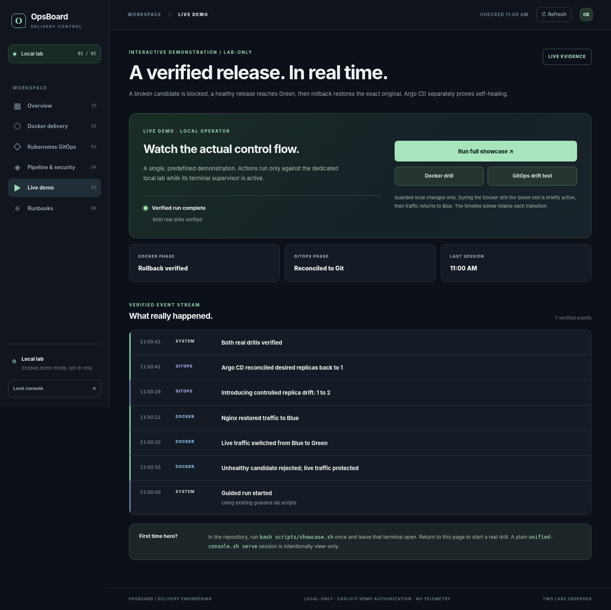
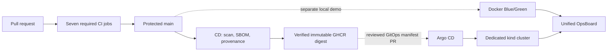
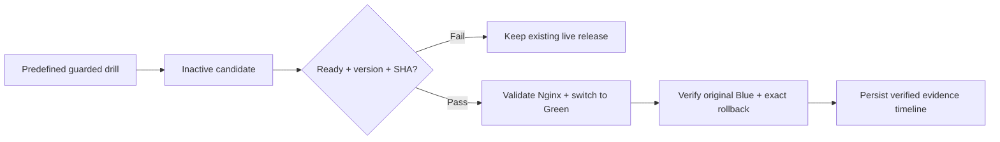
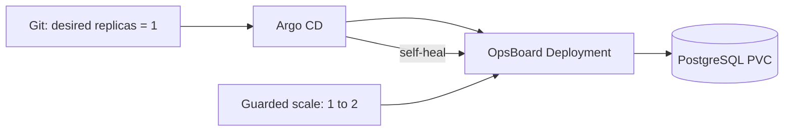

# OpsBoard — CI/CD & GitOps Control Center

*Developed by Moshe Bogo*

[](https://github.com/Mishkaaass/ci-cd-lab/actions/workflows/ci.yml) [](https://github.com/Mishkaaass/ci-cd-lab/actions/workflows/cd.yml) [](https://github.com/Mishkaaass/ci-cd-lab/releases/latest)

**One local interface. Two real recovery drills. Seven CI security and quality gates.**

OpsBoard is a hands-on delivery lab: it **rejects an unhealthy Docker release, promotes a verified one and rolls back to the exact original**, while a separate Kubernetes environment proves **Argo CD self-healing** after configuration drift. The same screen shows release status, an evidence timeline, cluster health and actual GitHub Actions job results.



*Interface preview uses illustrative data; verified results come only from the live local drills and GitHub Actions.*

> **Scope:** An isolated local learning lab, not a public production system or an AWS/EKS deployment. Docker Blue/Green and Kubernetes GitOps follow **separate paths** with independent environments and credentials. Publishing a scanned image to GHCR **does not** automatically promote it to Kubernetes.

## 5-minute recruiter demo

Requires **Linux**, **Python 3.14** for the full Docker demo (Python 3.11+ for viewer-only mode), Docker Engine + Compose, and Git. Kubernetes needs `kind` and `kubectl`. `gh auth login` enables private GitHub Actions job details. First-time installation and cluster downloads can take longer than five minutes.

**1. Start the lab and viewer (one terminal):**

```bash
git clone https://github.com/Mishkaaass/ci-cd-lab.git
cd ci-cd-lab
bash scripts/showcase.sh
```

This command reuses an existing local Docker lab when available or prepares the four Compose services without deleting volumes. It connects the Docker history API and opens the local viewer. With `kind` and `kubectl` installed, the launcher may also initialize its **dedicated** local GitOps cluster; this is an explicitly started lab, never an external cluster. If `sudo` is needed for Docker, authorization happens **in the terminal**, not in the browser. Leave this terminal running.

**2. Open one URL:** [**http://127.0.0.1:18002/**](http://127.0.0.1:18002/). Unlock with the private token stored *on your own machine*:

```bash
cat ~/.config/ci-cd-lab/unified-console/viewer.token
```

**What if it asks for a password?** The UI opens **before** the local lab is prepared. An amber **Action required** banner appears if Docker needs `sudo`. Return to the **same terminal** running `bash scripts/showcase.sh` and type your Linux password there (characters do not appear). **Never type a sudo password into the browser.** The UI resumes after authorization.

**Behind the scenes:** The **Live terminal** pane displays selected, sanitized lines from the real scripts: readiness, Nginx validation, traffic switching and rollback. It is **read-only** and deliberately hides arbitrary process output and secrets. The verified event timeline persists after rollback.

**3. Click _Live demo → Run full showcase_.** Two *real*, predefined tests execute through the foreground local supervisor. The screen retains the event timeline, so you can see the brief **Blue → Green → Blue** transition **after** the drill completes. It also records the Kubernetes **1 → 2 → 1** reconciliation. Click either individual drill to repeat just one.

| What to inspect | What success actually proves |
|---|---|
| **Docker / Blue–Green** | Broken candidate rejected; healthy candidate validated and promoted; rollback restores original version **and Git SHA** |
| **Kubernetes / GitOps** | Argo CD `Synced / Healthy`, application `1/1`, PVC `Bound`, deliberate replica drift repaired by Git |
| **Pipeline & security** | Real latest `main` GitHub Actions jobs, never invented green checks if the GitHub API is unavailable |

**Without Docker permissions or the cluster?** `bash scripts/unified-console.sh serve` opens the same dashboard in **read-only** mode, showing only sources that are actually reachable. This mode cannot request live drills. Existing Docker tests can also be run manually with `bash scripts/reviewer.sh drill`; GitOps with `bash scripts/gitops-demo.sh drift-test`.

## Architecture

**From code to reviewed, verified artifacts**



**Docker release discipline**



**GitOps reconciliation**



The displayed GitOps revision identifies the **manifest revision**; the application's running image can be an older, separately approved digest. Neither successful CI nor Argo CD sync proves a new image was promoted.

## Security and responsibilities

| Layer | What is enforced |
|---|---|
| **Source** | Protected `main`, seven required CI jobs: Python tests, code quality, dependency, secret, container, browser/API, isolated attack scan |
| **Supply chain** | Gitleaks, dependency checks, Trivy image policy, SBOM, provenance and published image digest verification |
| **Release guard** | Readiness gate, exact version/SHA checks, Nginx config validation, bounded traffic change, verified rollback |
| **GitOps** | Separate reviewed manifest promotion, digest-pinned workload, dedicated kubeconfig/context and Argo CD reconciliation |
| **Viewer** | Local loopback binding (`127.0.0.1`), private `0600` token, no external scripts, CSP, restricted host/origin, no Docker socket exposure |
| **Guided demo** | **Explicit opt-in** through `scripts/showcase.sh`; only three predefined actions (`all`, `docker`, `gitops`). Browser requests cannot supply shell commands, Docker flags, or Kubernetes targets. The unprivileged web process only queues requests; the separate foreground supervisor executes existing guarded scripts |

**Trust boundary:** While the locally authorized showcase launcher is active, a valid local Viewer token can request the **fixed lab drills**. Do not enable this on a shared or untrusted workstation. Normal `unified-console.sh serve` remains read-only. No general-purpose Deploy, arbitrary command executor, public API, or remote admin endpoint is exposed. `sudo` is handled in the launcher's terminal, never passed through HTTP. If a prerequisite is unavailable, the interface reports it rather than claiming success.

A green check means a declared test passed; it is **not** an enterprise security certification. `PVC Bound` means the volume is attached, not that backups exist. There is no production SSO, external HTTPS termination, HA or tested disaster recovery here.

## Operations and troubleshooting

| Symptom | Action |
|---|---|
| **Port 18002 occupied** | Stop the *previous* console with `Ctrl+C` in its terminal, then rerun `bash scripts/showcase.sh` |
| **Docker offline** | `bash scripts/reviewer.sh doctor` → `bash scripts/reviewer.sh up` → check [live version](http://127.0.0.1:8080/version) |
| **History missing / port 18001** | The showcase launcher starts `bash scripts/reviewer.sh dashboard` if needed; it reads the separate private `Viewer token file:`. Manual fallback: start that command in another terminal |
| **GitOps offline** | `bash scripts/gitops-demo.sh doctor` → `bash scripts/gitops-demo.sh up` → `bash scripts/gitops-demo.sh status`; only the dedicated `kind-opsboard-review` cluster is used |
| **CI job data unavailable** | `gh auth status` then `gh api repos/Mishkaaass/ci-cd-lab/actions/workflows/ci.yml/runs?branch=main\&per_page=1`; absent data is not interpreted as passing |
| **Drill shows Blue after success** | Expected: `drill` ends with an exact **rollback to Blue**. Open **Live demo** for the retained Green transition |
| **Viewer cannot click Run** | Start `bash scripts/showcase.sh` instead of the stand-alone viewer; the foreground terminal must remain open |

**Manual tests**, if you prefer scripts: `bash scripts/reviewer.sh status`, `bash scripts/reviewer.sh drill`, `bash scripts/gitops-demo.sh status`, `bash scripts/gitops-demo.sh drift-test`.

**Native Argo CD UI (optional):** `bash scripts/gitops-demo.sh ui` opens **https://127.0.0.1:18080**; login is `admin`, password is the `argocd-initial-admin-secret` inside the dedicated cluster. The optional legacy Kubernetes OpsBoard (`bash scripts/gitops-demo.sh app`, port `18081`) has another Viewer token at `opsboard-gitops-review/auth/viewer.token`. Do not paste secrets into issues or screenshots.

**Optional legacy interfaces:** Docker history: `http://127.0.0.1:18001/dashboard`; Kubernetes app: `http://127.0.0.1:18081/dashboard`. Find the Docker token file with `bash scripts/reviewer.sh tokens`. The unified console remains the default entry point.

**Stop safely:** `Ctrl+C` in the showcase terminal stops only the servers it started. Docker containers, kind resources and PostgreSQL PVCs are **preserved**. Do not run `docker compose down -v` or `bash scripts/gitops-demo.sh down --delete-my-lab` unless you explicitly intend data loss.

**Documentation:** [Guided demo operations](docs/unified-console.md) · [Docker](docs/demo-docker-blue-green.md) · [Kubernetes GitOps](docs/demo-kubernetes-argocd.md) · [GitOps runbook](docs/kubernetes-gitops.md) · [Security](docs/security-lab.md) · [CI](.github/workflows/ci.yml) · [CD](.github/workflows/cd.yml).

**Release policy:** Existing release tags and pinned Kubernetes image digests are never rewritten by this work. Merging a new commit to `main` may trigger the existing CD pipeline and update the mutable `latest` image tag; GitOps image promotion remains separate and reviewed.
