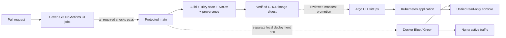
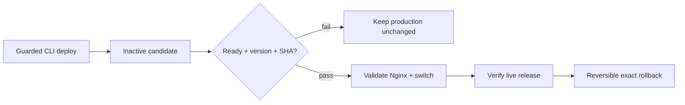
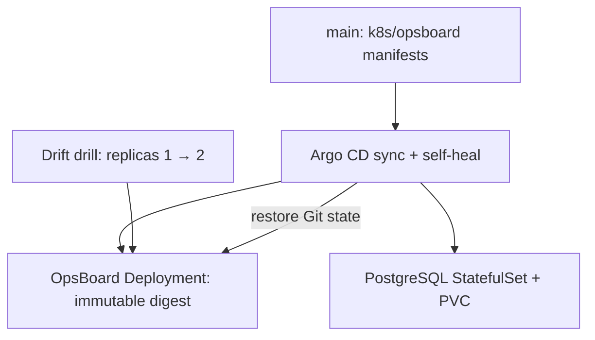

# OpsBoard — Secure Delivery & GitOps Lab

[](https://github.com/Mishkaaass/ci-cd-lab/actions/workflows/ci.yml) [](https://github.com/Mishkaaass/ci-cd-lab/actions/workflows/cd.yml) [](https://github.com/Mishkaaass/ci-cd-lab/releases/latest)

**A single local operations console for two independent deployment disciplines:** guarded Docker Blue/Green releases and Kubernetes GitOps reconciliation. Both are tested systems, not simulated dashboard numbers. All services bind locally; no AWS account is needed.

> **Scope:** A reproducible DevSecOps lab, **not** an internet-facing production service. Docker and Kubernetes are **separate paths** with separate state and credentials. Publishing an image to GHCR does **not automatically promote** it to Kubernetes.

## Start here — one console

Requirements: Linux, Git, Python 3.11+, Docker Engine/Compose for Docker, `kind` + `kubectl` for GitOps, optional authenticated `gh` for live CI information. The viewer console itself has **no third-party Python dependencies**, does not require root and does not issue Docker/Kubernetes write operations.

```bash
git clone https://github.com/Mishkaaass/ci-cd-lab.git
cd ci-cd-lab
bash scripts/unified-console.sh doctor
bash scripts/unified-console.sh
```

Open **http://127.0.0.1:18002**. To unlock, read your **private local** console viewer token **on your own computer**:

```bash
cat ~/.config/ci-cd-lab/unified-console/viewer.token
```

The console shows Docker release/slot health, live GitOps state, PostgreSQL PVC condition and latest CI results. **Unreachable components are marked unavailable**, never presented as passed. A unified **read-only** interface does not merge the operator privileges of the two labs. The credential stays in the current browser tab's memory; do not paste it into GitHub, logs, screenshots or messages.

**If an environment is offline**, start the relevant lab once using the commands below; return to the same console and click *Refresh*. Running the console does not create Docker containers or a Kubernetes cluster.

## How a change gets delivered



The **promotion boundary is intentional**: a healthy CI/CD run proves an artifact passed the declared gates. Kubernetes changes require a **separate reviewed manifest update** with an immutable image digest. A new image is not automatically promoted by Argo CD.

## Demo 1 · Docker Blue/Green — release safety



```bash
bash scripts/reviewer.sh doctor
bash scripts/reviewer.sh up
bash scripts/reviewer.sh status
bash scripts/reviewer.sh drill
```

- Live release: **http://127.0.0.1:8080/version**; central console: **http://127.0.0.1:18002**.
- `drill` intentionally rejects a broken candidate, promotes a healthy one, and verifies rollback to the original version and SHA.
- For **historical deployment events**, the existing API/dashboard can still run in another terminal (leave it open):

```bash
bash scripts/reviewer.sh dashboard
bash scripts/reviewer.sh tokens
```

The `tokens` command prints **`Viewer token file:`**. To retrieve that separate legacy viewer token locally:

```bash
VIEWER_FILE="$(bash scripts/reviewer.sh tokens | sed -n 's/^Viewer token file:[[:space:]]*//p')"
test -s "$VIEWER_FILE" && cat "$VIEWER_FILE"
```

The legacy API may be offline while the unified console still shows the live Docker release. The dashboard is read-only; privileged deployment commands stay in the guarded CLI. Never run `docker compose down -v` unless you intend to **delete database volumes**.

[Complete Docker walkthrough](docs/demo-docker-blue-green.md)

## Demo 2 · Kubernetes + Argo CD — desired state



```bash
bash scripts/gitops-demo.sh doctor
bash scripts/gitops-demo.sh up
bash scripts/gitops-demo.sh status
bash scripts/gitops-demo.sh drift-test
```

Expected: Argo CD **Synced / Healthy**, application **1/1**, PostgreSQL PVC **Bound**. The drift test proves replicas return to their Git-defined state; it **does not** test application image rollback.

For the native Argo CD interface, run `bash scripts/gitops-demo.sh ui` in a separate terminal and open **https://127.0.0.1:18080**. Username: **`admin`**. Retrieve its initial password from the local Kubernetes Secret (do not share it):

```bash
KCFG="${XDG_STATE_HOME:-$HOME/.local/state}/opsboard-gitops-review/kubeconfig"
kubectl --kubeconfig "$KCFG" --context kind-opsboard-review -n argocd \
  get secret argocd-initial-admin-secret -o jsonpath='{.data.password}' | base64 --decode
printf '\n'
```

The old Kubernetes OpsBoard is optional; use `bash scripts/gitops-demo.sh app` and **http://127.0.0.1:18081/dashboard**. It uses a **different viewer token**, stored in:

```bash
cat "${XDG_STATE_HOME:-$HOME/.local/state}/opsboard-gitops-review/auth/viewer.token"
```

Deleting the lab with `bash scripts/gitops-demo.sh down --delete-my-lab` **destroys its cluster and PVC data**. Do not run it unless that is intentional. A PVC is persistence, **not a backup**.

[Complete GitOps walkthrough](docs/demo-kubernetes-argocd.md)

## Security and trust boundaries

| Layer | Enforcement / purpose |
|---|---|
| Pull requests | Required CI checks on `main`; Python tests, quality, dependency, secrets, container, browser/API and isolated attack checks |
| Source and dependencies | **Gitleaks** secret scanning; dependency security checks |
| Published artifact | **Trivy** policy gate, **SBOM**, build **provenance**, published image **digest** and verification |
| Local release | Candidate readiness, release identity checks, bounded proxy switch, verified exact rollback |
| GitOps | Reviewed digest-pinned manifest, Argo CD reconciliation, dedicated kubeconfig/context |
| Unified console | Loopback-only HTTP, private 0600 viewer token, no CORS, CSP, no external JavaScript, read-only observation, no `sudo` or Docker socket access |

The console uses **one viewer login for visibility**, but does not combine Kubernetes admin, Docker operator or GitHub privileges in the browser. Underlying lab tokens and the Argo password remain private. In an actual internet-facing deployment, use SSO/MFA, managed secrets, role-based authorization, encrypted transport, audited actions, backups and monitoring.

## Where to look

- [Unified console design and troubleshooting](docs/unified-console.md)
- [Security lab and threat boundaries](docs/security-lab.md)
- [GitOps operating guide](docs/kubernetes-gitops.md)
- [Reviewer tour](docs/reviewer-tour.md)
- [CI workflow](.github/workflows/ci.yml) · [CD workflow](.github/workflows/cd.yml)

**Version policy:** This work does **not overwrite or move a published release tag**. New source commits and GHCR builds are new immutable artifacts. Existing release tags remain untouched; CD may move the `latest` container tag after a merge to `main`, according to the existing workflow. No automatic GitOps image promotion is introduced.
