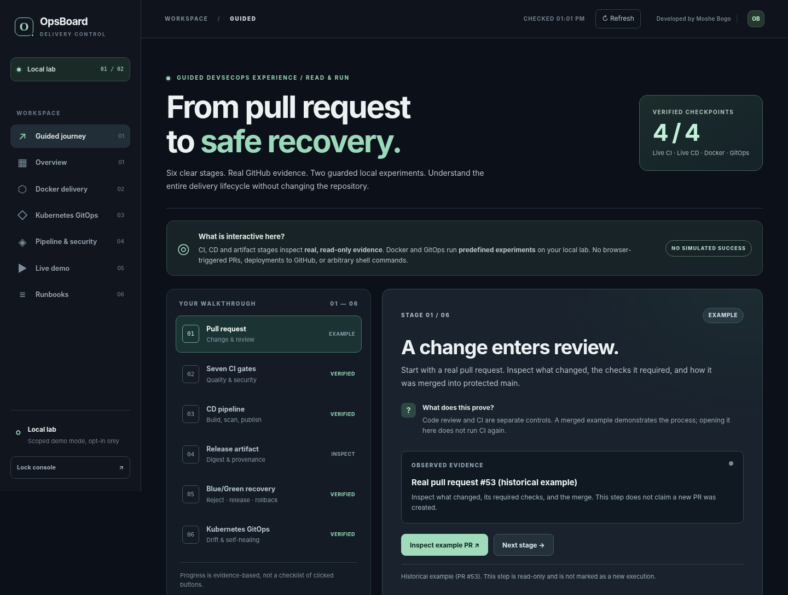
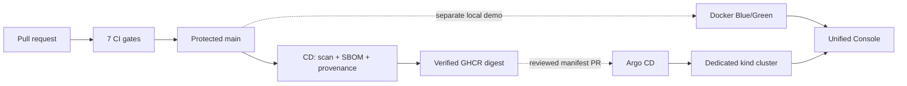
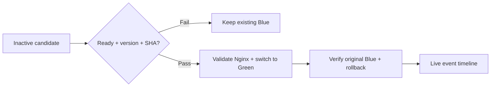
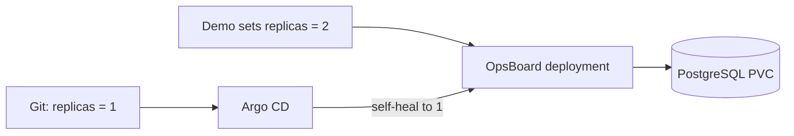

# OpsBoard — End-to-End DevSecOps & CI/CD Platform

**A complete, hands-on DevSecOps platform demonstrating secure software delivery, automated deployment validation, failure recovery, and infrastructure self-healing.**

OpsBoard integrates **GitHub Actions, Docker Blue/Green deployments, automated rollback, Kubernetes, Argo CD, and a unified monitoring dashboard** into a practical, locally reproducible environment.

The platform demonstrates real-world CI/CD workflows — from automated testing and security gates to verified deployments, traffic switching, GitOps reconciliation, and recovery from failed releases.

Through an interactive dashboard with **live deployment events, real CI results, and a read-only terminal**, reviewers can execute guided demonstrations and observe exactly what happens behind the scenes.

*Developed by Moshe Bogo*

[](https://github.com/Mishkaaass/ci-cd-lab/actions/workflows/ci.yml) [](https://github.com/Mishkaaass/ci-cd-lab/actions/workflows/cd.yml) [](https://github.com/Mishkaaass/ci-cd-lab/releases/latest)


*Preview data is illustrative. Live results are read from the actual local labs and GitHub Actions.*

## What does it do?

OpsBoard answers three practical questions:

| Question | What the lab demonstrates |
|---|---|
| **Can a bad release reach users?** | Docker Blue/Green checks the candidate's readiness, version and Git SHA. A broken candidate is **rejected** without switching traffic. |
| **Can we deploy and recover safely?** | A healthy candidate is promoted through Nginx, then a verified **rollback** restores the exact original version and SHA. |
| **Can infrastructure correct unexpected changes?** | Kubernetes + Argo CD detects replica **drift** (1 → 2) and restores the desired state from Git (→ 1). |

The **Unified Console** displays live status, a persistent evidence timeline, **Live terminal** output and real GitHub Actions results. Docker and Kubernetes follow **separate paths**: they are independent demonstrations, not two copies of the same application deployment.

> **Scope:** Local Linux lab, also supported from Windows through Ubuntu WSL 2 + Docker Desktop; not an AWS/EKS or internet-facing production environment. CI publishing a scanned container to GHCR **does not automatically deploy it to Kubernetes**. Kubernetes uses an independently reviewed, digest-pinned GitOps manifest.

## Guided Experience — understand the full delivery lifecycle

After launching OpsBoard, the first page is **Guided journey**: six stages
connecting a real pull request, **7 CI gates**, a matching **CD** run, artifact
inspection, **Blue/Green deployment + exact rollback**, and **Argo CD self-healing**.
CI/CD evidence is read-only: the browser **does not** trigger GitHub pipelines.
The two local labs run only their existing, fixed supervisor actions. Each step
explains *what happens*, *why it matters*, and *what proves the result*.

See the [step-by-step guided reviewer walkthrough](docs/guided-experience.md).

## Engineering Learning Lab — understand the infrastructure

Alongside the six-stage **Guided journey**, the sidebar now offers **Engineering lab**: six interactive learning modules with **18 real-world prediction scenarios** across Docker/Nginx, Kubernetes/Argo CD, FastAPI, PostgreSQL, CI/CD artifacts, and security. Each scenario includes multiple-choice decisions, a technical explanation, a relevant source link, and a live **read-only** snapshot when evidence is available.

The learning exercises **do not perform deployments, change traffic or Kubernetes, or execute shell commands**. To observe actual behavior, use the existing guarded **Live demo** actions separately. Quiz progress is local to the current browser tab and must never be mistaken for operational verification.

[Explore all 18 engineering exercises and their evidence boundaries](docs/engineering-learning-lab.md).

## 5-minute recruiter demo — start here

**Before you begin:** Linux, Git, Python **3.14**, Docker Engine and Docker Compose v2. For the Kubernetes drill, install `kind` and `kubectl`; GitHub CLI (`gh`) is recommended for detailed private CI results. Docker access may require your Linux `sudo` password. A first-time container build or cluster installation can take longer than five minutes.

**1. Start everything in one terminal.** Run these three commands:

```bash
git clone https://github.com/Mishkaaass/ci-cd-lab.git
cd ci-cd-lab
bash scripts/showcase.sh
```

Leave the terminal open. The launcher checks **all four Docker services** (`db`, `demo-blue`, `demo-green`, `nginx`) and the live proxy, not just whether port `8080` is open. If any service is missing or unhealthy, it prepares the lab automatically, verifies readiness, and preserves volumes. **No additional Docker commands or internal checkout paths are required.** If tools for GitOps are installed, it uses or prepares only the dedicated `kind-opsboard-review` cluster.

**2. Open [http://127.0.0.1:18002/](http://127.0.0.1:18002/)** on the same computer. Get your private Viewer token from a *second terminal*:

```bash
cat ~/.config/ci-cd-lab/unified-console/viewer.token
```

Paste the token into **Unlock**. Do not post it in screenshots, issues or chat. If **Action required: sudo** appears, enter your **Linux password in the original launcher terminal**, not in the browser. Nothing appears while you type; press Enter. The browser never receives the password.

**3. Click `Live Demo` → `Run full showcase`.** The local supervisor runs two predefined, real drills. Watch the **Live Terminal** and timeline, then inspect the Docker, Kubernetes and Security panels. The terminal pane shows selected, sanitized command output; it is **not** a shell prompt and cannot run arbitrary commands.

| During the demo | What you should see |
|---|---|
| **Docker — broken candidate** | Readiness fails; Blue remains live. |
| **Docker — healthy candidate** | Version/SHA and Nginx validation pass; production switches **Blue → Green**. |
| **Docker — rollback** | Production returns **Green → Blue**, matching the original version and SHA. **Blue after completion is expected.** |
| **Kubernetes — GitOps drift** | Argo CD restores replicas **1 → 2 → 1**, ending `Synced / Healthy`; PostgreSQL PVC remains `Bound`. |
| **Security / CI** | Seven real job results when GitHub access is available; missing API data appears as **Unavailable**, never fabricated success. |

Want to run only one test? Choose the separate **Docker** or **GitOps** action in Live Demo. To stop the local launcher, press `Ctrl+C` in its terminal; Docker volumes, kind cluster and PVC are preserved.

**Viewer-only mode:** `bash scripts/unified-console.sh serve` opens the interface without enabling the guided actions. For a manual advanced drill, see `bash scripts/reviewer.sh drill` and `bash scripts/gitops-demo.sh drift-test` below.

## Windows — WSL 2 + Docker Desktop

On Windows 10/11, run the **same Linux-based live demo** through Ubuntu WSL 2. First install [WSL 2 + Ubuntu](https://learn.microsoft.com/en-us/windows/wsl/install) and [Docker Desktop](https://docs.docker.com/desktop/features/wsl/) with WSL Integration enabled for Ubuntu. Open PowerShell **inside this repository**:

```powershell
powershell.exe -NoProfile -ExecutionPolicy Bypass -File .\scripts\windows-showcase.ps1
```

The launcher verifies Docker Desktop, sets up Python 3.14 and the Kubernetes tools **inside Ubuntu**, then starts the local console. Open `http://127.0.0.1:18002/` in Windows and click **Live Demo → Run full showcase**. Follow the terminal prompts for any first-time Ubuntu package installation or `sudo`; **never enter passwords in the browser**. Windows setup may take longer than five minutes; no native Windows container support is claimed.

[Step-by-step Windows setup, Viewer token and troubleshooting](docs/windows.md).

## Architecture in three small diagrams

**1. Software delivery and the two independent labs**



**2. Docker Blue/Green with safety gates**



**3. Kubernetes desired-state recovery**



**Important distinction:** A successful CI run publishes a verified artifact; it does **not** imply that artifact is currently running in Kubernetes. The Argo CD Git revision and the application image digest are different identities.

## Security, by design

- **Before merge:** Seven required CI gates cover Python tests, code quality, dependencies, secrets, containers, browser/API security and an isolated API attack scan. `main` is protected.
- **Supply chain:** Gitleaks, dependency auditing, Trivy image policy, SBOM, provenance and immutable image digest verification. The `latest` tag is not the deployment identity.
- **Release safety:** Readiness and exact release identity checks; Nginx configuration is validated before switching; rollback verifies the original deployment.
- **Access:** Local `127.0.0.1` only; private Viewer token, content security policy (CSP), host/origin checks and no exposed Docker socket. The normal dashboard is read-only.
- **Guided actions:** Explicit opt-in by running `scripts/showcase.sh`. While that trusted foreground supervisor runs, a valid local Viewer token may request only three fixed local lab actions (`all`, `docker`, `gitops`). The browser cannot supply shell commands or choose arbitrary Kubernetes targets. Use only on a trusted workstation.
- **Boundaries:** `sudo` stays in the terminal. PostgreSQL PVC persistence is **not** a backup. This lab does not claim SSO, public TLS, high availability, production rollout or disaster-recovery certification.

## If something doesn't work

| Symptom | What to do |
|---|---|
| **`18002` does not open** | Keep `bash scripts/showcase.sh` running. Stop an older console occupying the port with `Ctrl+C` in **its own** terminal; then retry. |
| **Waiting for a password** | Return to the launcher terminal and approve `sudo` there. Do not type a sudo password into the web UI. |
| **Docker not ready** | The launcher checks all four Compose services and automatically repairs missing services. If it still fails, read the clear error in the **launcher terminal**; advanced diagnostics: `bash scripts/reviewer.sh doctor` |
| **CI jobs unavailable** | Authenticate locally: `gh auth login` then `gh auth status`. Advanced API check: `gh api repos/Mishkaaass/ci-cd-lab/actions/workflows/ci.yml/runs?branch=main\&per_page=1`. API failure is unknown, not green. |
| **Kubernetes unavailable** | Install `kind`/`kubectl` and check `bash scripts/gitops-demo.sh doctor`, `bash scripts/gitops-demo.sh status`; optional lab setup: `bash scripts/gitops-demo.sh up`. |
| **Dashboard shows Blue after the test** | Correct: the demo deliberately **rolls back to Blue**. Read the event timeline to see Green's verified promotion. |
| **History / port `18001` missing** | The launcher manages the Docker history API. For advanced troubleshooting: `bash scripts/reviewer.sh dashboard`; its output includes `Viewer token file:`. |

**Optional manual commands:** `bash scripts/reviewer.sh status`, `bash scripts/reviewer.sh tokens`, `bash scripts/reviewer.sh up`, `bash scripts/reviewer.sh drill`, `bash scripts/gitops-demo.sh drift-test`, `bash scripts/gitops-demo.sh ui` (Argo CD at `https://127.0.0.1:18080`) and `bash scripts/gitops-demo.sh app` (legacy OpsBoard at `http://127.0.0.1:18081/dashboard`). Argo CD uses a separate `admin` account and its `argocd-initial-admin-secret`; never treat it as the OpsBoard Viewer token.

**Safe shutdown:** `Ctrl+C` stops the launcher; it **does not delete** Docker volumes, the Kubernetes cluster or PostgreSQL PVC. Do not run `docker compose down -v` or `bash scripts/gitops-demo.sh down --delete-my-lab` unless data loss is intentional.

**Details for engineers:** [Unified runbook](docs/unified-console.md) · [Docker walkthrough](docs/demo-docker-blue-green.md) · [GitOps walkthrough](docs/demo-kubernetes-argocd.md) · [GitOps runbook](docs/kubernetes-gitops.md) · [Security model](docs/security-lab.md) · [CI](.github/workflows/ci.yml) · [CD](.github/workflows/cd.yml) · [Releases](https://github.com/Mishkaaass/ci-cd-lab/releases)

**Release policy:** Existing release tags and pinned Kubernetes images are not rewritten by this documentation change. A merge into `main` may still run the existing CD and update the mutable `latest` tag.
