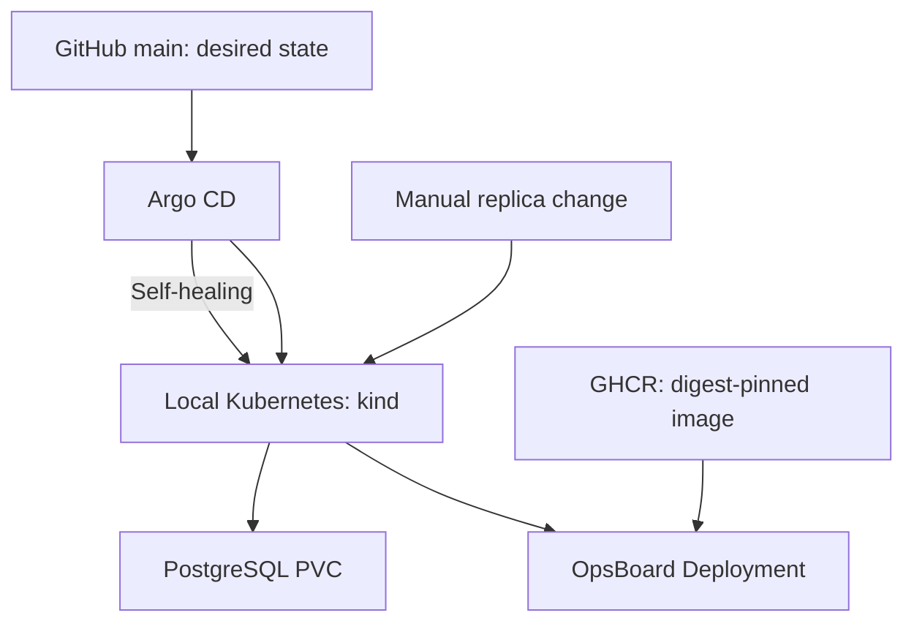

# Demo 2 | Kubernetes + Argo CD — real GitOps

**What you're proving:** Kubernetes runs the application, while Argo CD watches Git and **corrects configuration drift**. This is a **separate demo** from Docker Blue/Green; you can run either one independently.

**How it works:** The script creates an isolated kind Kubernetes cluster called `opsboard-review`, installs Argo CD, and applies the app definition from the repository's **GitHub `main` branch**. Kubernetes runs OpsBoard + PostgreSQL, with persistent storage in a PVC. Argo CD keeps the cluster aligned with Git.

## Architecture at a glance



## Before you start

- **Linux** with Git, Bash, `curl` and internet access.
- Working **Docker Engine**, **kind** and **kubectl**. Install kind and kubectl from their [official](https://kind.sigs.k8s.io/docs/user/quick-start/) [guides](https://kubernetes.io/docs/tasks/tools/).
- Free local ports `18080` (Argo CD) and `18081` (OpsBoard).
- Enough free resources to run a Kubernetes control plane, Argo CD, OpsBoard and PostgreSQL.
- The GitHub repository **and** its GHCR image must be readable. Both are public for the official OpsBoard demo; private forks need read-only credentials ([advanced setup](kubernetes-gitops.md)).

### 1. Download (once)

```bash
git clone https://github.com/Mishkaaass/ci-cd-lab.git
cd ci-cd-lab
```

Already cloned it for Demo 1? Just use the same directory. You **do not need** to start the Docker Blue/Green demo first.

### 2. Check requirements, then create the lab

```bash
bash scripts/gitops-demo.sh doctor
bash scripts/gitops-demo.sh up
```

`doctor` must say the tools and Git source are available. `up` creates **only its own** cluster and a private kubeconfig under `~/.local/state/opsboard-gitops-review/`. It generates credentials **outside the repository**, installs Argo CD and waits for the app to become healthy. **No AWS account is needed.**

### 3. Confirm the real deployment

```bash
bash scripts/gitops-demo.sh status
```

Look for **`Synced` + `Healthy`**, a Kubernetes Deployment **`1/1`**, running OpsBoard/PostgreSQL Pods and a **`Bound`** PVC. Argo CD syncs **GitHub `main`**, not your uncommitted local changes.

### 4. Open both interfaces (optional)

**Terminal A — Argo CD:**

```bash
bash scripts/gitops-demo.sh ui
```

Open [https://127.0.0.1:18080](https://127.0.0.1:18080). The local HTTPS certificate is self-signed, so your browser may warn about it. For this **localhost-only** demo, continue only if you understand you're connecting to your own port-forward. Log in as **`admin`**. Retrieve the initial password locally with:

```bash
kubectl --kubeconfig "$HOME/.local/state/opsboard-gitops-review/kubeconfig" \
  --context kind-opsboard-review -n argocd \
  get secret argocd-initial-admin-secret \
  -o jsonpath='{.data.password}' | base64 --decode
printf '\n'
```

Never post the password or a screenshot containing it.

**Terminal B — OpsBoard running in Kubernetes:**

```bash
bash scripts/gitops-demo.sh app
```

Open [http://127.0.0.1:18081/dashboard](http://127.0.0.1:18081/dashboard). The **viewer token** is stored locally at `~/.local/state/opsboard-gitops-review/auth/viewer.token`. Both port-forward terminals must remain running while you use the interfaces.

### 5. Prove Argo CD actually reconciles changes

**Terminal C — run the live test:**

```bash
bash scripts/gitops-demo.sh drift-test
bash scripts/gitops-demo.sh status
```

The test temporarily changes the OpsBoard Deployment from **1 replica to 2**. Git still says **1**, so Argo CD detects the difference and restores **1**. Expected result: `PASS: real GitOps self-healing restored replicas=1`.

**This is self-healing, not a rollback of a new Docker image.** New images are published by CI/CD, but Kubernetes changes image only after a **reviewed GitOps manifest update**. See the [advanced GitOps runbook](kubernetes-gitops.md).

### 6. Finish safely

- **Close interfaces:** `Ctrl+C` in each port-forward terminal. The cluster **keeps running**.
- **Keep the lab:** Do nothing. You can run `status` later.
- **Delete only this disposable lab (optional):** `bash scripts/gitops-demo.sh down --delete-my-lab`. **WARNING:** This destroys `opsboard-review`, including its PostgreSQL PVC data. Other clusters are not the target; the script checks its ownership before deletion.
- **Never** delete an unfamiliar cluster or treat kind PVCs as backups.

**Trouble?** See [Troubleshooting](reviewer-tour.md) for `ImagePullBackOff`, `OutOfSync`, access and port issues.

[← Back to main README](../README.md)
