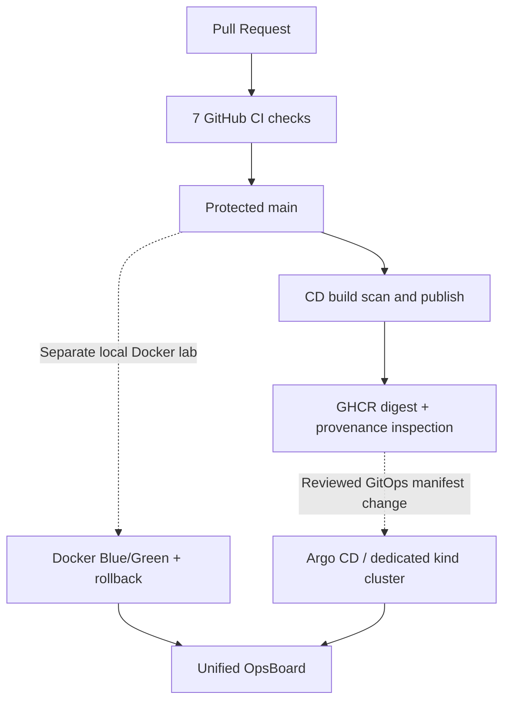

# Guided DevSecOps Experience

The reviewer journey connects **code review → CI → CD → artifact verification →
Docker release safety → Kubernetes GitOps recovery**. It separates observation
from real local actions rather than pretending every click triggers a pipeline.

## Start

From the repository root on a supported Linux lab, run:

```bash
bash scripts/showcase.sh
```

Open `http://127.0.0.1:18002/`, unlock with the **local Viewer Token**, and
follow the **Guided journey** (the first page after login). Keep the launcher
terminal open. If prompted, enter your `sudo` password **in that terminal**;
never paste it into the browser. For Windows, follow [Windows/WSL2 setup](windows.md)
and use `scripts/windows-showcase.ps1`.

## What you will learn

| Stage | What to do | What is real evidence? |
|---|---|---|
| 1. Pull request | Open a historical PR example. | A reviewable change and its check history. This does **not** create a PR. |
| 2. Seven CI gates | Inspect the latest main CI run and seven job results. | Actual GitHub checks; missing data is never considered success. |
| 3. CD pipeline | Compare the most recent main CI and CD runs. | Both report success **and their complete Git SHAs match**. |
| 4. Artifact | Inspect the CD publishing job, GHCR digest, SBOM and provenance separately. | A successful CD run alone does **not** independently verify the image digest. |
| 5. Blue/Green | Click **Run Docker demonstration** and watch **Live Demo**. | Broken candidate rejected; Green receives traffic only after checks; exact Blue rollback. |
| 6. GitOps | Click **Run GitOps demonstration** and watch **Live Demo**. | Dedicated kind cluster reconciles replica drift **1 → 2 → 1** via Argo CD. |

## Architecture and trust boundaries



**Important:** The Docker Blue/Green drill is a separate local lab, not an
automatic deployment of the newest GHCR artifact. Publishing an image to GHCR
does **not** automatically change the image running under Argo CD. Neither
reviewing CI nor reviewing CD from this dashboard schedules a GitHub job.

The **Viewer Token** authorizes access to local observations. Only the
explicitly started, foreground `scripts/showcase.sh` supervisor accepts
three whitelisted local actions (`all`, `docker`, `gitops`); the browser does
not receive a shell, a Docker socket, or a user-defined Kubernetes target.
The Live Terminal displays filtered, allowlisted output, not an interactive
terminal. Progress badges are derived from returned evidence, not clicks.

## Interpreting the badges

- **VERIFIED** — supported by observed job results or an allowlisted local
  success marker; these local markers remain visible within the current tab.
- **OLDER RUN / CHECK** — the CD job or its evidence does not match the
  observed CI revision; inspect GitHub instead of inferring success.
- **INSPECT** — the artifact SHA256 digest and provenance are not independently
  fetched by the local console. Inspect the publishing workflow and GHCR.
- **NOT RUN** — the corresponding local experiment has not produced a verified
  result during the current browser session.

## Presenter checklist

1. Explain a real PR and all seven gates; show the source commit.
2. Confirm that the latest main-branch CD run matches that commit.
3. Point out the distinct GHCR digest/provenance evidence requirement.
4. Run the broken Docker candidate, healthy Green switch and Blue rollback.
5. Run GitOps drift and show Argo reconciliation in the read-only timeline.
6. Stop the local operator with `Ctrl+C`. Local volumes and PVC remain intact.

If GitHub is not authenticated or network access is unavailable, the CI/CD
panels show missing information honestly; the local Docker/GitOps lab can be
inspected independently. A cluster that is stopped is not evidence of a
successful reconciliation.

## Optional hands-on CI challenge — in **your own fork only**

This is the **one part of the walkthrough where you really start a CI run**.
It is deliberately separate from the local dashboard. Do not use the
upstream `Mishkaaass/ci-cd-lab` repository for this exercise.

1. Fork the repository to **your own GitHub account**. Check that the URL is
   `github.com/<YOUR_ACCOUNT>/ci-cd-lab`, not the original owner.
2. If GitHub Actions is disabled on your fork, enable it in your fork's
   **Actions** settings. Review the workflows before enabling them.
3. Create an isolated feature branch in the fork and add a failing test:

   ```python
   # tests/test_guided_ci_challenge.py  — in your own fork only
   def test_ci_gate_blocks_a_broken_change():
       assert False, "intentional CI exercise — expect red"
   ```

4. Commit and push the branch to **your fork**. Open a pull request whose
   **base repository is your fork**, not `Mishkaaass/ci-cd-lab`.
5. Open **Checks**. The Python-tests CI gate should fail. Observe how the
   PR is blocked from a successful result.
6. Change `assert False` to `assert True`, commit and push to the same fork
   branch. Watch the checks rerun, with the Python gate now green.
7. **Do not merge the practice PR.** You can close it in your fork afterwards.

This exercise only tests the CI part. CD in a new fork may require different
permissions, package ownership and repository settings. A green CI run in a
fork **does not** mean that the original project's CD or GHCR image was
changed. No production, upstream or Kubernetes resources are touched.
